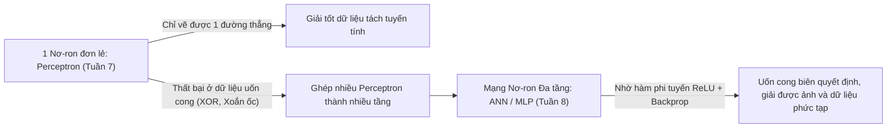

# TÀI LIỆU TỰ HỌC TỪ SỐ 0: PERCEPTRON (TUẦN 7) & MẠNG NƠ-RON ANN / MLP (TUẦN 8)
*(Hiểu bản chất từ con số 0 — Từ trực giác, công thức toán, giải phẫu từng dòng code NumPy đến thực hành `scikit-learn`)*

> **Tài liệu gốc đi kèm trong Workspace**:
> - Tuần 7 (Perceptron): [thuchanh_bai_Perceptron_2025.pdf](file:///d:/MachineLearning/week7/thuchanh_bai_Perceptron_2025.pdf), [NguyenHaiAnh_24001968_week7_perceptron.ipynb](file:///d:/MachineLearning/week7/NguyenHaiAnh_24001968_week7_perceptron.ipynb)
> - Tuần 8 (ANN / MLP): [thuchanh_bai_ANN_MLP_2024.pdf](file:///d:/MachineLearning/week8/thuchanh_bai_ANN_MLP_2024.pdf), [NguyenHaiAnh_24001968_week8_ann_mlp.ipynb](file:///d:/MachineLearning/week8/NguyenHaiAnh_24001968_week8_ann_mlp.ipynb), [PCA_ANN_Face_Classification.ipynb](file:///d:/MachineLearning/week8/PCA_ANN_Face_Classification.ipynb)

---

## MỤC LỤC
1. [Bức tranh toàn cảnh: Mối liên hệ giữa Tuần 7 và Tuần 8](#1-bức-tranh-toàn-cảnh-mối-liên-hệ-giữa-tuần-7-và-tuần-8)
2. [PHẦN I (TUẦN 7): PERCEPTRON ĐƠN TẦNG (SINGLE-LAYER PERCEPTRON)](#2-phần-i-tuần-7-perceptron-đơn-tầng-single-layer-perceptron)
   - [2.1. Trực giác đời thường: Bộ não của 1 nơ-ron nhân tạo](#21-trực-giác-đời-thường-bộ-não-của-1-nơ-ron-nhân-tạo)
   - [2.2. Công thức toán & Quy ước gộp bias (`X_bar`)](#22-công-thức-toán--quy-ước-gộp-bias-x_bar)
   - [2.3. Tại sao dùng nhãn `{-1, +1}` & Quy tắc cập nhật PLA](#23-tại-sao-dùng-nhãn--1-1--quy-tắc-cập-nhật-pla)
   - [2.4. Điều kiện hội tụ & Thuật toán Pocket khi dữ liệu bị chồng lấn](#24-điều-kiện-hội-tụ--thuật-toán-pocket-khi-dữ-liệu-bị-chồng-lấn)
   - [2.5. Giải phẫu code Tự cài đặt PLA (cả 2 quy ước Cột và Hàng)](#25-giải-phẫu-code-tự-cài-pla-cả-2-quy-ước-cột-và-hàng)
   - [2.6. Thực hành với Scikit-learn (`Perceptron`) & So sánh với Logistic Regression](#26-thực-hành-với-scikit-learn-perceptron--so-sánh-với-logistic-regression)
3. [PHẦN II (TUẦN 8): MẠNG NƠ-RON ĐA TẦNG — ANN / MLP (MULTI-LAYER PERCEPTRON)](#3-phần-ii-tuần-8-mạng-nơ-ron-đa-tầng--ann--mlp-multi-layer-perceptron)
   - [3.1. Khi 1 Perceptron bó tay: Bài toán phi tuyến (XOR & Xoắn ốc 2D)](#31-khi-1-perceptron-bó-tay-bài-toán-phi-tuyến-xor--xoắn-ốc-2d)
   - [3.2. Tại sao phải ghép nhiều tầng & Tại sao BẮT BUỘC có hàm `ReLU`?](#32-tại-sao-phải-ghép-nhiều-tầng--tại-sao-bắt-buộc-có-hàm-relu)
   - [3.3. Kiến trúc mạng ANN 3 tầng & Bí kíp nhớ kích thước ma trận không bao giờ sai](#33-kiến-trúc-mạng-ann-3-tầng--bí-kíp-nhớ-kích-thước-ma-trận-không-bao-giờ-sai)
   - [3.4. Giải phẫu 4 giai đoạn huấn luyện ANN (Forward, Loss, Backprop, Update)](#34-giải-phẫu-4-giai-đoạn-huấn-luyện-ann-forward-loss-backprop-update)
   - [3.5. Thực hành Tuần 8 bằng Scikit-learn (`MLPClassifier`) & Kết hợp PCA](#35-thực-hành-tuần-8-bằng-scikit-learn-mlpclassifier--kết-hợp-pca)
4. [PHẦN III: TỔNG KẾT SO SÁNH, 8 BẪY KINH ĐIỂN & BỘ CÂU HỎI VẤN ĐÁP](#4-phần-iii-tổng-kết-so-sánh-8-bẫy-kinh-điển--bộ-câu-hỏi-vấn-đáp)

---

## 1. Bức tranh toàn cảnh: Mối liên hệ giữa Tuần 7 và Tuần 8

Nếu ví một mô hình phân loại giống như **một giám khảo chấm điểm**, thì Tuần 7 và Tuần 8 chính là **hai thế hệ tiến hóa từ đơn giản lên mạnh mẽ**:



- **Tuần 7 — Perceptron (PLA)**: Là **1 tế bào thần kinh nhân tạo duy nhất**. Nó cộng các đặc trưng theo trọng số, nhìn dấu âm/dương rồi **vẽ đúng 1 đường thẳng** (hoặc mặt phẳng) chia đôi 2 lớp.
- **Tuần 8 — Multi-Layer Perceptron (MLP / ANN)**: Thay vì chỉ dùng 1 Perceptron, người ta **xếp hàng trăm Perceptron thành một lớp ở giữa (gọi là Tầng ẩn - Hidden Layer)**, gắn thêm công tắc phi tuyến (`ReLU`), rồi đưa sang tầng cuối (`Softmax`) để phân loại nhiều lớp có hình dạng xoắn ốc, uốn cong hay dữ liệu ảnh phức tạp!

---

## 2. PHẦN I (TUẦN 7): PERCEPTRON ĐƠN TẦNG (SINGLE-LAYER PERCEPTRON)

### 2.1. Trực giác đời thường: Bộ não của 1 nơ-ron nhân tạo

Hãy tưởng tượng bạn muốn quyết định xem **có nên duyệt vay tiền (`+1`) hay từ chối (`-1`)** cho một người dựa trên 2 thông số:
- $x_1$: Thu nhập hàng tháng (triệu đồng)
- $x_2$: Số năm kinh nghiệm làm việc

Bộ não của Perceptron làm việc rất giống con người chấm điểm:
1. Gắn **mức độ quan trọng (trọng số $w$)** cho từng thông số, cộng thêm một **ngưỡng nền $w_0$ (bias)**:
   $$z = w_0 + w_1 x_1 + w_2 x_2$$
2. Kiểm tra xem tổng điểm $z$ là **dương hay âm** bằng **hàm dấu (`sign`)**:
   $$\hat{y} = \text{sign}(z) = \begin{cases} +1 & \text{nếu } z \ge 0 \quad (\text{Duyệt}) \\ -1 & \text{nếu } z < 0 \quad (\text{Từ chối}) \end{cases}$$

Ranh giới giữa hai quyết định chính là chỗ $z = 0$:
$$w_0 + w_1 x_1 + w_2 x_2 = 0$$
Trên mặt phẳng 2D $(x_1, x_2)$, đây là **phương trình một đường thẳng**!  
Nếu rút $x_2$ theo $x_1$, ta có ngay công thức vẽ đường phân chia:
$$x_2 = -\frac{w_1 x_1 + w_0}{w_2}$$
*(Đây chính xác là công thức trong hàm `draw_line(w)` ở bài thực hành Tuần 7!)*

---

### 2.2. Công thức toán & Quy ước gộp bias (`X_bar`)

Khi viết code với nhiều thuộc tính $x_1, x_2, \dots, x_d$, viết rời $w_0 + w_1 x_1 + \dots + w_d x_d$ rất dài dòng. Người ta dùng một mẹo cực gọn: **tưởng tượng có thêm một đặc trưng giả $x_0 = 1$ đứng ở đầu**.

- Vector đặc trưng mở rộng: $\bar{\mathbf{x}} = [1, x_1, x_2, \dots, x_d]^T$
- Vector trọng số mở rộng: $\mathbf{w} = [w_0, w_1, w_2, \dots, w_d]^T$

Khi đó phép tính tổng thu gọn thành **1 phép nhân vô hướng duy nhất**:
$$z = w_0 \cdot 1 + w_1 x_1 + \dots + w_d x_d = \mathbf{w}^T \bar{\mathbf{x}}$$

> **Giải thích dòng code `X_bar` trong notebook Tuần 7**:  
> Khi bạn thấy dòng `X_bar = np.concatenate((np.ones((1, 2 * N)), X), axis=0)` (theo quy ước cột: mỗi cột là 1 mẫu), nó chỉ đang làm đúng một việc là **dán thêm 1 hàng toàn số `1` lên trên cùng của bảng `X`** để nhân gọn với `w0`!

---

### 2.3. Tại sao dùng nhãn `{-1, +1}` & Quy tắc cập nhật PLA

Ở Tuần 3 (Logistic Regression), nhãn thường là `{0, 1}`. Sang Tuần 7 (Perceptron), nhãn lại đổi thành **`{-1, +1}`**. Tại sao?

Vì khi nhãn $y_i \in \{-1, +1\}$, chỉ cần nhìn **tích $y_i \cdot (\mathbf{w}^T \bar{\mathbf{x}}_i)$** là biết ngay máy đoán đúng hay sai:
- Nếu $y_i = +1$ và máy ra $z > 0$ (cùng dấu $+$) $\implies$ tích $y_i \cdot z > 0$ (**Đoán ĐÚNG**).
- Nếu $y_i = -1$ và máy ra $z < 0$ (cùng dấu $-$) $\implies$ tích $y_i \cdot z > 0$ (**Đoán ĐÚNG**).
- Nếu trái dấu nhau $\implies$ tích $y_i \cdot z \le 0$ (**Đoán SAI**).

#### Thuật toán học Perceptron (PLA — Perceptron Learning Algorithm) hoạt động ra sao?
PLA học theo kiểu **"sai đâu sửa đấy"** (Stochastic):
1. Khởi tạo ngẫu nhiên đường thẳng $\mathbf{w}$ ban đầu.
2. Xáo trộn thứ tự các điểm dữ liệu, duyệt qua từng điểm $(\bar{\mathbf{x}}_i, y_i)$:
   - Nếu máy **đoán ĐÚNG** ($\hat{y}_i = y_i$): **Giữ nguyên $\mathbf{w}$, không làm gì cả!**
   - Nếu máy **đoán SAI** ($\hat{y}_i \ne y_i$): **Xoay đường thẳng $\mathbf{w}$ lại gần điểm đó** theo công thức duy nhất:
     $$\mathbf{w}_{\text{mới}} = \mathbf{w}_{\text{cũ}} + y_i \cdot \bar{\mathbf{x}}_i \qquad (\text{hoặc } \mathbf{w}_{\text{cũ}} + \eta \cdot y_i \bar{\mathbf{x}}_i)$$

#### Chứng minh 2 dòng: Tại sao cộng `yi * xi` lại sửa đúng lỗi?
Hãy thay $\mathbf{w}_{\text{mới}}$ vào tính lại điểm số cho chính điểm $\bar{\mathbf{x}}_i$ vừa bị đoán sai:
$$\mathbf{w}_{\text{mới}}^T \bar{\mathbf{x}}_i = (\mathbf{w}_{\text{cũ}} + y_i \bar{\mathbf{x}}_i)^T \bar{\mathbf{x}}_i = \mathbf{w}_{\text{cũ}}^T \bar{\mathbf{x}}_i + y_i \underbrace{\|\bar{\mathbf{x}}_i\|_2^2}_{\text{luôn } > 0}$$

- Trường hợp 1: Điểm này vốn là **nhãn `+1`**, nhưng lúc nãy máy đoán nhầm ra số âm ($\mathbf{w}_{\text{cũ}}^T \bar{\mathbf{x}}_i < 0$). Khi cộng thêm $+1 \cdot \|\bar{\mathbf{x}}_i\|_2^2 > 0$, giá trị mới **tăng vọt lên phía dương** $\rightarrow$ tiến về phía đoán đúng `+1`!
- Trường hợp 2: Điểm này vốn là **nhãn `-1`**, nhưng lúc nãy máy đoán nhầm ra số dương ($\mathbf{w}_{\text{cũ}}^T \bar{\mathbf{x}}_i > 0$). Khi cộng thêm $-1 \cdot \|\bar{\mathbf{x}}_i\|_2^2 < 0$, giá trị mới **tụt mạnh xuống phía âm** $\rightarrow$ tiến về phía đoán đúng `-1`!

*(Chính nhờ cơ chế này mà sau mỗi lần sửa, đường thẳng sẽ tự động xoay dần về phía tách đúng các điểm!)*

---

### 2.4. Điều kiện hội tụ & Thuật toán Pocket khi dữ liệu bị chồng lấn

- **Khi dữ liệu tách tuyến tính được (Linearly Separable)** (tồn tại ít nhất 1 đường thẳng cắt đứt hoàn toàn 2 lớp không dính nhau): Định lý Hội tụ Perceptron chứng minh rằng **PLA chắc chắn dừng sau một số hữu hạn bước lặp** (`has_converged == True`).
- **Khi dữ liệu KHÔNG tách tuyến tính được** (2 lớp có vài điểm đè lên nhau — ví dụ thực tế trong [sonar.all-data.csv](file:///d:/MachineLearning/week7/sonar.all-data.csv) hay [framingham.csv](file:///d:/MachineLearning/week7/framingham.csv)):
  - Luôn có ít nhất 1 điểm bị đoán sai $\implies$ vòng `while True` sẽ **chạy vĩnh viễn không bao giờ dừng**!
  - **Cách xử lý bắt buộc (Thuật toán Pocket — bỏ túi bộ tốt nhất)**:
    1. Đặt giới hạn số vòng lặp tối đa `max_epochs=1000`.
    2. Mỗi lần cập nhật được bộ trọng số mới, đếm xem nó đoán sai bao nhiêu điểm trên toàn tập train. Nếu ít lỗi nhất từ trước tới nay, cất ngay vào "túi" (`best_w`).
    3. Hết `max_epochs` mà chưa hội tụ thì trả về `best_w`!

---

### 2.5. Giải phẫu code Tự cài đặt PLA (cả 2 quy ước Cột và Hàng)

#### Quy ước A: Theo slide & notebook Tuần 7 (Ma trận CỘT: `X_bar` có shape `(d+1, N)`)
Đây là code dùng trực tiếp trong [NguyenHaiAnh_24001968_week7_perceptron.ipynb](file:///d:/MachineLearning/week7/NguyenHaiAnh_24001968_week7_perceptron.ipynb):

```python
import numpy as np

# Giả sử X có shape (d, N) -> mỗi cột là 1 mẫu; y có shape (1, N) mang giá trị +1 hoặc -1
# 1. Ghép thêm 1 hàng toàn số 1 lên đầu để tạo X_bar có shape (d + 1, N)
N = X.shape[1]
X_bar = np.concatenate((np.ones((1, N)), X), axis=0)

# 2. Hàm dự đoán nhãn (+1 hoặc -1) cho ma trận x
def h(w, x):
    return np.sign(np.dot(w.T, x))

# 3. Kiểm tra xem đường thẳng w đã đoán đúng 100% tập dữ liệu chưa
def has_converged(X_in, y_in, w):
    return np.array_equal(h(w, X_in), y_in)

# 4. Vòng lặp huấn luyện PLA (kèm Pocket Algorithm chống lặp vô hạn)
def perceptron(X_in, y_in, w_init, max_epochs=1000):
    w = [w_init]
    d, N_samples = X_in.shape
    mis_points = []
    best_w = w_init
    min_err = N_samples + 1

    for _ in range(max_epochs):
        mix_id = np.random.permutation(N_samples)     # xáo trộn thứ tự các mẫu mỗi epoch
        for i in range(N_samples):
            xi = X_in[:, mix_id[i]].reshape(d, 1)     # lấy cột thứ mix_id[i] thành vector cột (d, 1)
            yi = y_in[0, mix_id[i]]                   # nhãn thật (+1 hoặc -1)
            pred = h(w[-1], xi)[0, 0]
            if pred == 0:                             # BẪY: np.sign(0) trả về 0 -> ép về +1!
                pred = 1
            if pred != yi:                            # nếu đoán sai -> cập nhật!
                mis_points.append(mix_id[i])
                w_new = w[-1] + yi * xi               # công thức PLA cốt lõi
                w.append(w_new)
                err = np.sum(h(w_new, X_in) != y_in)  # đếm số lỗi trên toàn tập để lưu best_w
                if err < min_err:
                    min_err = err
                    best_w = w_new
        if has_converged(X_in, y_in, w[-1]):          # đoán đúng sạch -> dừng sớm!
            break

    if not has_converged(X_in, y_in, w[-1]):
        w.append(best_w)
    return w, mis_points
```

> [!WARNING]
> **Bẫy `np.sign(0) == 0`**: Khi khởi tạo trọng số hoặc có điểm nằm đúng trên đường thẳng $z = 0$, hàm `np.sign(0)` của NumPy trả về **`0`** chứ không phải `+1` hay `-1`! Vì nhãn thật `yi` chỉ là `+1` hoặc `-1`, nếu không xử lý `if pred == 0: pred = 1`, điểm đó luôn bị tính là đoán sai (`0 != yi`).

#### Quy ước B: Theo chuẩn HÀNG `(N, d)` (Dễ dùng khi làm bài test tự động / khớp `sklearn`)
Khi đi thi, dữ liệu đọc từ Pandas/Sklearn luôn có dạng mỗi **hàng** là 1 mẫu `(N, d)` và nhãn thường là `{0, 1}`. Bạn có thể tự cài gọn sạch bằng hàm dưới đây (đã kiểm chứng đạt **96.49%** trên Breast Cancer):

```python
import numpy as np

def fit_perceptron_row(X_in, y_01, eta=1.0, max_epochs=200, seed=42):
    """X_in: (N, d), y_01: nhãn 0 hoặc 1."""
    rng = np.random.default_rng(seed)
    y_pm = np.where(y_01 == 1, 1, -1)                 # đổi nhãn 0/1 sang -1/+1
    N, d = X_in.shape
    w = np.zeros(d, dtype=float)
    b = 0.0
    best_w, best_b, min_err = w.copy(), b, N + 1

    for _ in range(max_epochs):
        errors = 0
        for i in rng.permutation(N):
            z = float(X_in[i] @ w + b)
            pred = 1 if z >= 0 else -1
            if pred != y_pm[i]:
                w += eta * y_pm[i] * X_in[i]
                b += eta * y_pm[i]
                errors += 1
        err_all = int(np.sum(np.where(X_in @ w + b >= 0, 1, -1) != y_pm))
        if err_all < min_err:
            min_err, best_w, best_b = err_all, w.copy(), b
        if errors == 0:
            return w, b
    return best_w, best_b

def predict_perceptron_row(X_in, w, b):
    return np.where(X_in @ w + b >= 0, 1, 0)          # đổi lại về nhãn 0/1
```

---

### 2.6. Thực hành với Scikit-learn (`Perceptron`) & So sánh với Logistic Regression

Trong `scikit-learn`, mô hình nằm ở `sklearn.linear_model.Perceptron` (và **nên luôn chuẩn hóa dữ liệu** bằng `StandardScaler` trước khi huấn luyện, nhất là khi các cột chênh lệch đơn vị như Breast Cancer 30D hoặc Framingham 15D):

```python
from sklearn.model_selection import train_test_split
from sklearn.preprocessing import StandardScaler
from sklearn.linear_model import Perceptron
from sklearn.metrics import accuracy_score, precision_score, recall_score

# 1. Chia Train / Test (nhớ stratify=y nếu phân loại)
X_train, X_test, y_train, y_test = train_test_split(
    X, y, test_size=0.3, stratify=y, random_state=42
)

# 2. Chuẩn hóa đặc trưng (CHỈ fit trên Train!)
scaler = StandardScaler()
X_train_sc = scaler.fit_transform(X_train)
X_test_sc  = scaler.transform(X_test)

# 3. Khởi tạo & huấn luyện Perceptron
clf = Perceptron(max_iter=1000, eta0=1.0, random_state=42)
clf.fit(X_train_sc, y_train)

# 4. Dự đoán & đánh giá
y_pred = clf.predict(X_test_sc)
print("Accuracy :", accuracy_score(y_test, y_pred))
print("Trọng số w:", clf.coef_)        # shape (1, d) cho bài toán nhị phân
print("Bias w0   :", clf.intercept_)   # shape (1,)
```

#### So sánh nhanh: Perceptron vs Logistic Regression (Rất hay hỏi thi!)
| Tiêu chí | `Perceptron` (Tuần 7) | `LogisticRegression` (Tuần 3) |
|---|---|---|
| **Biên quyết định** | Đường thẳng / siêu phẳng tuyến tính | Đường thẳng / siêu phẳng tuyến tính |
| **Cách học** | Chỉ sửa khi đoán sai (`sign`), **dừng ngay** ở đường đầu tiên phân tách đúng | Tối ưu hàm mất mát **Cross-Entropy** trên toàn bộ mẫu |
| **Độ ổn định khi dữ liệu chồng lấn** | Dễ dao động theo thứ tự mẫu, ranh giới có thể nằm lệch sát 1 lớp | Ổn định hơn, ranh giới nằm cân bằng ở giữa (như trên Sonar & Framingham 2D) |
| **Đầu ra xác suất (`predict_proba`)** | **Không có** (chỉ có nhãn cứng hoặc `decision_function`) | **Có** xác suất mượt từ $0$ đến $1$ |

---

## 3. PHẦN II (TUẦN 8): MẠNG NƠ-RON ĐA TẦNG — ANN / MLP (MULTI-LAYER PERCEPTRON)

### 3.1. Khi 1 Perceptron bó tay: Bài toán phi tuyến (XOR & Xoắn ốc 2D)

Hãy nhìn bài toán **3 nhánh xoắn ốc 2D** trong Ví dụ 1 của [NguyenHaiAnh_24001968_week8_ann_mlp.ipynb](file:///d:/MachineLearning/week8/NguyenHaiAnh_24001968_week8_ann_mlp.ipynb): 3 lớp điểm xanh, đỏ, lục cuộn vào nhau như chong chóng.

- **Perceptron (Tuần 7)** và **Logistic Regression** chỉ vẽ được **các đường thẳng**. Bạn xoay kiểu gì cũng không có đường thẳng nào tách được 3 nhánh xoắn vào nhau!
- **Mạng Nơ-ron Đa tầng (ANN / Multi-Layer Perceptron — MLP)** sinh ra để giải quyết chính giới hạn này: ghép nhiều nơ-ron lại để **uốn cong đường ranh giới theo mọi hình thù**.

---

### 3.2. Tại sao phải ghép nhiều tầng & Tại sao BẮT BUỘC có hàm `ReLU`?

1. **Ý tưởng hình học**:  
   Hãy tưởng tượng bạn cần cắt một hình tam giác hoặc vòng xoắn ốc bằng kéo: 1 nhát cắt thẳng (1 Perceptron) không bao giờ cắt được hình đa giác. Nhưng nếu dùng **100 nhát cắt thẳng ở Tầng ẩn**, rồi ở **Tầng ra** bạn gộp các nhát cắt đó lại ("nằm bên trái đường 1 VÀ bên phải đường 2 VÀ phía trên đường 3"), bạn có thể bao vây bất kỳ hình dạng uốn lượn nào!
2. **Tại sao BẮT BUỘC phải có hàm kích hoạt phi tuyến (Activation Function) như `ReLU`?**  
   - Giả sử không có `ReLU`, tầng 1 tính $Z_1 = W_1^T X$, tầng 2 tính $Z_2 = W_2^T Z_1$.  
   - Thay vào: $Z_2 = W_2^T (W_1^T X) = (W_1 W_2)^T X = W_{\text{gộp}}^T X$.  
   - Kết quả **vẫn chỉ là 1 phép biến đổi tuyến tính (1 đường thẳng)**! Dù bạn xếp 100 tầng mà không có hàm phi tuyến ở giữa thì sức mạnh cũng chỉ ngang đúng 1 tầng!
3. **Hàm kích hoạt `ReLU` (Rectified Linear Unit)** cực kỳ đơn giản:
   $$\text{ReLU}(z) = \max(0, z) = \begin{cases} z & \text{nếu } z > 0 \\ 0 & \text{nếu } z \le 0 \end{cases}$$
   - Trong NumPy viết đúng 1 dòng: `np.maximum(Z, 0)`.
   - Tác dụng: Bẻ gập đường thẳng tại điểm `0` để tạo tính phi tuyến, tính toán siêu nhanh và ít bị triệt tiêu đạo hàm như `Sigmoid`.

---

### 3.3. Kiến trúc mạng ANN 3 tầng & Bí kíp nhớ kích thước ma trận không bao giờ sai

Trong bài thực hành Tuần 8 (Xoắn ốc 2D, Iris, MNIST, Dry Bean, Yale Faces), mạng chuẩn gồm **3 tầng** (quy ước mỗi **cột** của `X` là 1 mẫu, nên `X` có shape `(d0, N)`):

- **Tầng đầu vào (Input Layer)**: $d_0$ chiều (ví dụ Xoắn ốc 2D: $d_0 = 2$; Iris: $d_0 = 4$; Dry Bean: $d_0 = 16$; Yale Faces sau PCA: $d_0 = 125$).
- **1 Tầng ẩn (Hidden Layer)**: $d_1$ nơ-ron (ví dụ `d1 = 100`), dùng hàm kích hoạt **`ReLU`**.
- **Tầng đầu ra (Output Layer)**: $C$ nút (bằng số lớp cần phân loại), dùng hàm **`Softmax`** để xuất ra xác suất cộng lại bằng `1.0`.

#### Bảng "chốt chết" kích thước ma trận (Chỉ cần khớp 2 số đứng cạnh nhau!)

| Thành phần | Công thức | Kích thước (Shape) | Giải thích dễ nhớ |
|---|---|---|---|
| Đầu vào `X` | — | `(d0, N)` | `d0` đặc trưng $\times$ `N` mẫu |
| Ma trận trọng số tầng 1 `W1`, `b1` | — | `W1: (d0, d1)`, `b1: (d1, 1)` | Nối từ `d0` đầu vào $\to$ `d1` nơ-ron ẩn |
| Tổng tuyến tính tầng ẩn `Z1` | `W1.T @ X + b1` | `(d1, d0) @ (d0, N) = (d1, N)` | Mỗi cột là đầu ra chưa qua ReLU của 1 mẫu |
| Đầu ra tầng ẩn `A1` | `np.maximum(Z1, 0)` | `(d1, N)` | Giữ phần dương, xóa phần $\le 0$ thành `0` |
| Ma trận trọng số tầng 2 `W2`, `b2` | — | `W2: (d1, C)`, `b2: (C, 1)` | Nối từ `d1` nơ-ron ẩn $\to$ `C` lớp đầu ra |
| Điểm số thô `Z2` & Xác suất `Yhat` | `Z2 = W2.T @ A1 + b2`, `Yhat = softmax(Z2)` | `(C, N)` | Mỗi cột là xác suất rơi vào `C` lớp của 1 mẫu |

> **Bí kíp kiểm tra shape bằng mắt trong 3 giây**:  
> Khi viết phép nhân ma trận `A @ B`, hai con số nằm kề nhau phải giống hệt nhau (ví dụ `(d1, d0) @ (d0, N)` $\to$ gạch bỏ `d0` ở giữa còn `(d1, N)`). Khi viết code `dW2` hay `dW1`, chỉ cần kiểm tra sao cho **`dW` có shape Y HỆT `W`**!

---

### 3.4. Giải phẫu 4 giai đoạn huấn luyện ANN (Forward, Loss, Backprop, Update)

Toàn bộ quá trình học của mạng nơ-ron thực chất chỉ là lặp lại vòng `for` gồm **4 bước liên tiếp**:

```text
[1] Lan truyền xuôi (Forward)  : X -> Z1 -> A1 (ReLU) -> Z2 -> Yhat (Softmax)
[2] Tính lỗi (Loss)            : So sánh dự đoán Yhat với nhãn One-hot thật Y_oh
[3] Lan truyền ngược (Backprop): Tính độ dốc (đạo hàm) E2 -> dW2, db2 -> E1 -> dW1, db1
[4] Cập nhật (Gradient Descent): Trừ dần theo hướng giảm lỗi: W -= eta * dW
```

#### Giải thích tường minh từng dòng của Bước 3 (Backpropagation — chỗ khó nhớ nhất!)
Trong file [NguyenHaiAnh_24001968_week8_ann_mlp.ipynb](file:///d:/MachineLearning/week8/NguyenHaiAnh_24001968_week8_ann_mlp.ipynb), đoạn lan truyền ngược chỉ có **7 dòng** cực gọn:

```python
# 1. Sai số tại đầu ra (đạo hàm gộp tuyệt đẹp của Softmax + Cross-Entropy)
E2 = (Yhat - Y_oh) / n_samples      # shape: (C, N) — dự đoán lệch thật bao nhiêu

# 2. Đạo hàm của tầng 2 (nhìn shape để nhớ thứ tự nhân!)
#    A1 có shape (d1, N), E2.T có shape (N, C) -> A1 @ E2.T có shape (d1, C) == shape W2!
dW2 = np.dot(A1, E2.T)
db2 = np.sum(E2, axis=1, keepdims=True)  # cộng ngang theo N mẫu -> shape (C, 1) == shape b2!

# 3. Truyền sai số ngược qua W2 về tầng ẩn
#    W2 có shape (d1, C), E2 có shape (C, N) -> W2 @ E2 có shape (d1, N) == shape A1!
E1 = np.dot(W2, E2)

# 4. Đi ngược qua hàm ReLU:
#    ReLU(z) = z nếu z > 0 (đạo hàm = 1, giữ nguyên sai số), và = 0 nếu z <= 0 (đạo hàm = 0, tắt sai số!)
E1[Z1 <= 0] = 0

# 5. Đạo hàm của tầng 1
#    X_tr có shape (d0, N), E1.T có shape (N, d1) -> X_tr @ E1.T có shape (d0, d1) == shape W1!
dW1 = np.dot(X_tr, E1.T)
db1 = np.sum(E1, axis=1, keepdims=True)  # shape (d1, 1) == shape b1!
```

#### Bộ code hoàn chỉnh Self-Contained của ANN 1 tầng ẩn (đã kiểm chứng trên Iris đạt 96.67%)
```python
import numpy as np

def softmax_col(Z):
    """Softmax theo cột (axis=0), có trừ max để chống tràn số exp()."""
    e = np.exp(Z - np.max(Z, axis=0, keepdims=True))
    return e / np.sum(e, axis=0, keepdims=True)

def one_hot_col(y_idx, C):
    """Chuyển nhãn [0, 1, 2...] dài N thành ma trận (C, N) toàn 0 và 1."""
    Y = np.zeros((C, len(y_idx)), dtype=float)
    Y[y_idx, np.arange(len(y_idx))] = 1.0
    return Y

def train_ann(X_col, y_idx, C, d1=100, eta=0.1, n_iters=2000, seed=42):
    rng = np.random.default_rng(seed)
    d0, N = X_col.shape
    Y = one_hot_col(y_idx, C)

    # QUAN TRỌNG: Phải khởi tạo W nhỏ ngẫu nhiên (KHÔNG được khởi tạo toàn 0!)
    W1 = 0.01 * rng.standard_normal((d0, d1))
    b1 = np.zeros((d1, 1))
    W2 = 0.01 * rng.standard_normal((d1, C))
    b2 = np.zeros((C, 1))

    for _ in range(n_iters):
        # 1. Forward
        Z1 = W1.T @ X_col + b1
        A1 = np.maximum(Z1, 0)                      # ReLU
        Z2 = W2.T @ A1 + b2
        Yhat = softmax_col(Z2)

        # 2. Backprop
        E2 = (Yhat - Y) / N
        dW2 = A1 @ E2.T
        db2 = np.sum(E2, axis=1, keepdims=True)
        E1 = W2 @ E2
        E1[Z1 <= 0] = 0                             # Đạo hàm ReLU
        dW1 = X_col @ E1.T
        db1 = np.sum(E1, axis=1, keepdims=True)

        # 3. Update (Gradient Descent)
        W1 -= eta * dW1
        b1 -= eta * db1
        W2 -= eta * dW2
        b2 -= eta * db2

    return W1, b1, W2, b2

def predict_ann(W1, b1, W2, b2, X_col):
    A1 = np.maximum(W1.T @ X_col + b1, 0)
    Z2 = W2.T @ A1 + b2
    return np.argmax(Z2, axis=0)
```

> [!CAUTION]
> **Tại sao CẤM khởi tạo `W1 = np.zeros(...)` trong ANN?**  
> Nếu `W1` toàn bằng `0`, mọi nơ-ron ở tầng ẩn đều nhận cùng một tín hiệu và cùng một đạo hàm y hệt nhau $\implies$ cả 100 nơ-ron học giống hệt nhau như 1 nơ-ron duy nhất (mất tác dụng đa tầng!). Khởi tạo nhỏ ngẫu nhiên `0.01 * randn` giúp phá vỡ tính đối xứng (*Symmetry Breaking*) để mỗi nơ-ron học một hướng cắt khác nhau.

---

### 3.5. Thực hành Tuần 8 bằng Scikit-learn (`MLPClassifier`) & Kết hợp PCA

Trong thực hành với thư viện `scikit-learn` (như bài Iris, MNIST, Dry Bean 16D $\to$ 4D, Yale Faces $\to$ 125D PCA), dùng **`Pipeline`** kết hợp `StandardScaler` + (tùy chọn `PCA`) + `MLPClassifier` là cách chuẩn nhất để vừa sạch code vừa **chống tuyệt đối Data Leakage**:

```python
from sklearn.model_selection import train_test_split
from sklearn.preprocessing import StandardScaler
from sklearn.decomposition import PCA
from sklearn.neural_network import MLPClassifier
from sklearn.pipeline import Pipeline
from sklearn.metrics import accuracy_score, classification_report

# 1. Chia Train / Test trước tiên (giữ tỷ lệ lớp bằng stratify=y)
X_train, X_test, y_train, y_test = train_test_split(
    X, y, test_size=0.3, stratify=y, random_state=42
)

# 2. Đóng gói Pipeline: Chuẩn hóa -> (Giảm chiều PCA nếu cần) -> MLPClassifier
pipe = Pipeline([
    ("scaler", StandardScaler()),
    ("pca", PCA(n_components=4, random_state=42)),   # bỏ dòng này nếu dùng dữ liệu gốc
    ("mlp", MLPClassifier(
        hidden_layer_sizes=(100,),   # 1 tầng ẩn gồm 100 nơ-ron (nhiều tầng ghi (100, 50))
        activation="relu",           # hàm kích hoạt tầng ẩn ('relu', 'tanh', 'logistic')
        solver="adam",               # bộ tối ưu hóa (nhanh & ổn định hơn SGD thuần)
        alpha=0.0001,                # hệ số điều chuẩn L2 chống overfitting
        max_iter=500,                # tăng lên 500-1000 nếu gặp cảnh báo ConvergenceWarning
        random_state=42,
    )),
])

# 3. Huấn luyện & Đánh giá
pipe.fit(X_train, y_train)
y_pred = pipe.predict(X_test)
print("Accuracy:", accuracy_score(y_test, y_pred))
print(classification_report(y_test, y_pred, zero_division=0))
```

#### Hiện tượng thực nghiệm cần nhớ từ các bài tập Tuần 8:
1. **Ảnh hưởng của số nơ-ron tầng ẩn (`d1 = 100, 75, 50`)**: Số nơ-ron ẩn càng lớn thì mạng càng uốn lượn linh hoạt và học lâu hơn; nhưng nếu dữ liệu ít mẫu mà mạng quá to, mô hình dễ bị **Overfitting** (Train 100%, Validation tụt).
2. **Ảnh hưởng của giảm chiều PCA (`Dry Bean 16D -> 4D`, `Yale Faces -> 125D`)**:
   - **Lợi**: Giảm mạnh thời gian huấn luyện và loại bớt nhiễu/chiều dư thừa.
   - **Hại**: Mất một phần thông tin chi tiết nên độ chính xác thường giảm nhẹ nếu nén quá sâu.
   - **So sánh trên tập ít mẫu như Yale Faces (165 ảnh / 15 người)**: ANN/MLP nhiều tham số dễ **học vẹt** trên tập Train (100%) nhưng Test lại thấp hơn Multinomial Logistic Regression (76% vs 88%). Còn trên tập nhiều mẫu và biên phi tuyến rõ (Xoắn ốc 2D, MNIST 5000 ảnh), ANN **vượt trội** hoàn toàn mô hình tuyến tính!

---

## 4. PHẦN III: TỔNG KẾT SO SÁNH, 8 BẪY KINH ĐIỂN & BỘ CÂU HỎI VẤN ĐÁP

### 4.1. Bảng so sánh 4 mô hình phân loại đã học (Tuần 2 $\rightarrow$ Tuần 8)

| Mô hình | Trường phái & Dạng biên | Cần Scale dữ liệu? | Giải được dữ liệu phi tuyến (Xoắn ốc/XOR)? | Điểm cần lưu ý |
|---|---|---|---|---|
| **Gaussian Naïve Bayes** (Tuần 2) | Mô hình sinh (Xác suất chuẩn độc lập) | **Không** | Có thể cong (bậc 2), nhưng giả sử các cột độc lập | Siêu nhanh, hợp dữ liệu nhỏ; kém nếu các cột phụ thuộc mạnh |
| **Logistic / Softmax Regression** (Tuần 3–4) | Tuyến tính (Cross-Entropy) | **Có** | **Không** (chỉ vẽ mặt phẳng thẳng) | Rất ổn định, có xác suất mượt, ít overfit khi ít mẫu |
| **Perceptron (PLA)** (Tuần 7) | Tuyến tính (Hàm dấu `sign`, sửa khi sai) | **Có** | **Không** (không hội tụ nếu không tách tuyến tính) | Phải có `max_epochs` / Pocket; không có `predict_proba` |
| **ANN / MLP** (Tuần 8) | Mạng nơ-ron đa tầng + `ReLU` + `Softmax` | **Bắt buộc** | **CÓ** (xấp xỉ được mọi ranh giới cong) | Nhiều tham số, chạy lâu hơn, dễ overfit nếu dữ liệu quá ít |

---

### 4.2. 8 Bẫy kinh điển khiến code Tuần 7 & Tuần 8 chạy lỗi hoặc sai điểm

| # | Bẫy hay gặp | Hậu quả | Cách tránh |
|---|---|---|---|
| 1 | Dùng nhãn `{0, 1}` đưa thẳng vào công thức cập nhật `w += yi * xi` của PLA | Khi `yi = 0`, `w` **không bao giờ được cập nhật**! | Đổi nhãn sang `{-1, +1}` trước khi tự cài PLA |
| 2 | Quên xử lý `np.sign(0) == 0` | Điểm có `z = 0` bị coi là đoán sai mãi | Viết `if pred == 0: pred = 1` (hoặc `1 if z >= 0 else -1`) |
| 3 | Nhầm quy ước `(d+1, N)` của slide tự cài với `(N, d)` của `sklearn` | Lỗi `ValueError: shapes not aligned` | Kiểm tra `.shape` ngay trước khi truyền vào `fit` / `predict` |
| 4 | Không đặt `max_epochs` / Pocket khi chạy PLA trên Sonar, Framingham | Vòng lặp `while True` treo máy vĩnh viễn | Luôn dùng `for _ in range(max_epochs)` và lưu `best_w` |
| 5 | Khởi tạo `W1 = np.zeros(...)` trong ANN | Mọi nơ-ron ẩn học giống hệt nhau, mạng mất khả năng phi tuyến | Luôn khởi tạo `0.01 * rng.standard_normal(...)` |
| 6 | Không chuẩn hóa dữ liệu (`StandardScaler` hoặc `/ 255.0`) trước ANN/Perceptron | Gradient bùng nổ ra `NaN`, hoặc `ReLU` chết hàng loạt | Luôn dùng `StandardScaler` (**fit chỉ trên Train!**) |
| 7 | `fit` `StandardScaler` hoặc `PCA` trên toàn bộ dữ liệu trước `train_test_split` | **Data Leakage**, điểm Validation cao giả tạo | Chia `train_test_split` TRƯỚC, rồi mới `fit_transform` Train |
| 8 | Học phí `eta` quá lớn (vd `eta = 10`) hoặc quên `one-hot` khi tính `E2 = Yhat - Y` | Loss tăng vọt thành `inf` / `NaN`, lỗi trừ shape `(C, N)` với `(N,)` | Giữ `eta` vừa phải (`0.05`–`1.0` tùy bài đã scale) và nhớ đổi `y` sang One-Hot `(C, N)` |

---

### 4.3. 5 Câu hỏi vấn đáp / trắc nghiệm "tủ" của Tuần 7 & Tuần 8

1. **Hỏi: Tại sao Perceptron (PLA) không chạy mãi trên dữ liệu tách tuyến tính, nhưng lại treo máy nếu dữ liệu chồng lấn?**  
   *Đáp*: Định lý hội tụ PLA đảm bảo thuật toán dừng sau hữu hạn bước *chỉ khi* tồn tại đường phân chia đúng 100% hai lớp. Nếu dữ liệu chồng lấn, luôn còn điểm bị sai nên điều kiện dừng `has_converged` không bao giờ thỏa mãn $\rightarrow$ phải giới hạn `max_epochs` và dùng Pocket Algorithm giữ bộ trọng số ít lỗi nhất.

2. **Hỏi: Điểm khác biệt lớn nhất giữa Perceptron và Logistic Regression là gì?**  
   *Đáp*: Cả hai đều vẽ biên tuyến tính, nhưng Perceptron chỉ cập nhật tại các điểm sai và dừng ở đường đầu tiên tách đúng (không có xác suất), còn Logistic Regression tối ưu Cross-Entropy trên toàn bộ mẫu nên cho biên cân bằng hơn và có xác suất đầu ra.

3. **Hỏi: Vì sao ANN/MLP bắt buộc phải có hàm kích hoạt phi tuyến như `ReLU` giữa các tầng?**  
   *Đáp*: Nếu không có hàm phi tuyến, tích liên tiếp nhiều ma trận tuyến tính $W_2^T(W_1^T X)$ vẫn suy biến về một phép nhân tuyến tính duy nhất $(W_1 W_2)^T X$, không thể tạo ranh giới cong để giải bài toán phi tuyến như XOR hay Xoắn ốc 2D.

4. **Hỏi: Trong bước lan truyền ngược của hàm `ReLU`, dòng `E1[Z1 <= 0] = 0` có ý nghĩa gì?**  
   *Đáp*: Đạo hàm của $\text{ReLU}(z)$ bằng `1` khi $z > 0$ và bằng `0` khi $z \le 0$. Theo quy tắc dây chuyền (*Chain Rule*), tại những vị trí $Z_1 \le 0$ nơ-ron bị tắt nên gradient truyền ngược qua đó phải bị triệt tiêu về `0`.

5. **Hỏi: Tại sao khi đưa ảnh hoặc dữ liệu bảng nhiều chiều qua `StandardScaler` + `PCA` rồi mới vào `MLPClassifier`, ta không được `fit` PCA trên toàn bộ tập dữ liệu?**  
   *Đáp*: Để tránh rò rỉ dữ liệu (**Data Leakage**). Trung bình, độ lệch chuẩn và các thành phần chính của PCA chỉ được phép học từ tập Train (`fit_transform(X_train)`), sau đó tập Validation/Test chỉ được phép áp dụng lại phép biến đổi đó (`transform(X_test)`).
