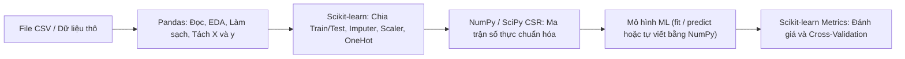
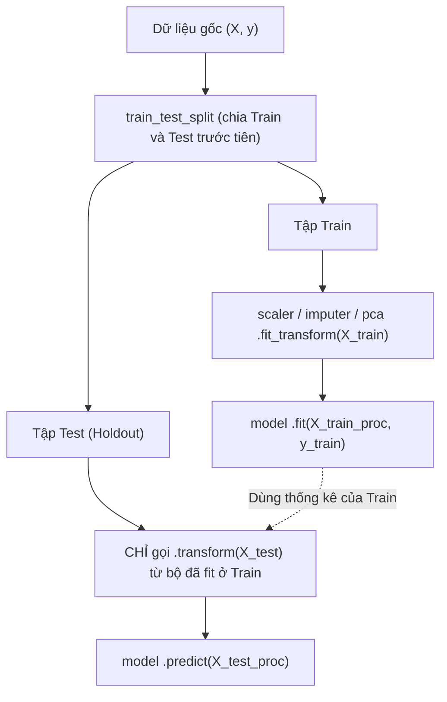

# CẨM NANG TOÀN TẬP: NUMPY, PANDAS & SCIKIT-LEARN CHO MÔN HỌC MÁY (MACHINE LEARNING)

> **Phạm vi**: Tổng hợp toàn bộ nền tảng kỹ thuật cần nắm để vừa **tự cài đặt thuật toán từ đầu** (NumPy), **xử lý & khám phá dữ liệu bảng** (Pandas), vừa **xây dựng pipeline, huấn luyện và đánh giá mô hình chuẩn công nghiệp** (Scikit-learn).  
> **Phiên bản tham chiếu trong môi trường hiện tại**: `numpy 2.4.6` · `pandas 3.1.0` · `scikit-learn 1.9.1`.

---

## MỤC LỤC
1. [Bức tranh tổng thể & Quy ước dữ liệu bất biến trong ML](#1-bức-tranh-tổng-thể--quy-ước-dữ-liệu-bất-biến-trong-ml)
2. [PHẦN I: NUMPY — Đại số tuyến tính, Vectorization & Tự cài thuật toán](#2-phần-i-numpy--đại-số-tuyến-tính-vectorization--tự-cài-thuật-toán)
3. [PHẦN II: PANDAS — Khám phá (EDA), Làm sạch & Biến đổi dữ liệu bảng](#3-phần-ii-pandas--khám-phá-eda-làm-sạch--biến-đổi-dữ-liệu-bảng)
4. [PHẦN III: SCIKIT-LEARN — Pipeline, Mô hình, Giảm chiều, Phân cụm & Đánh giá](#4-phần-iii-scikit-learn--pipeline-mô-hình-giảm-chiều-phân-cụm--đánh-giá)
5. [PHẦN IV: 10 Cạm bẫy chí mạng & Bộ Template Code chuẩn](#5-phần-iv-10-cạm-bẫy-chí-mạng--bộ-template-code-chuẩn)
6. [Tài liệu chuyên sâu theo từng tuần trong Workspace](#6-tài-liệu-chuyên-sâu-theo-từng-tuần-trong-workspace)

---

## 1. Bức tranh tổng thể & Quy ước dữ liệu bất biến trong ML

Ba thư viện đóng 3 vai trò nối tiếp nhau trong một quy trình Học máy hoàn chỉnh:



### Quy ước hình dáng (Shape) bắt buộc phải nhớ
Trong `scikit-learn` (và hầu hết thư viện Python ML):
- **Ma trận đặc trưng `X`**: luôn là mảng **2D** có shape `(n_samples, n_features)` — ký hiệu $(N, d)$: mỗi **hàng** là một mẫu quan sát, mỗi **cột** là một thuộc tính.
- **Vector mục tiêu `y`**: thường là mảng **1D** có shape `(n_samples,)` — ký hiệu $(N,)$ (hoặc 2D `(N, C)` nếu mã hóa One-Hot khi tự cài Softmax Regression).

> [!WARNING]
> **Bẫy đổi trục giữa Slide Toán / Tự cài NumPy và Scikit-learn**:  
> Nhiều tài liệu bài giảng tự cài từ đầu (như Linear/Logistic Regression, Perceptron) quy ước vector cột $\mathbf{x} \in \mathbb{R}^{d \times 1}$, nên ma trận dữ liệu $X$ có shape `(d, N)` (mỗi cột là 1 mẫu). Khi chuyển sang `scikit-learn`, `X` **bắt buộc** có shape `(N, d)`. Nếu đọc nhầm quy ước, phép nhân ma trận `X @ w` hoặc `.T` sẽ báo lỗi `ValueError` hoặc ra kết quả sai hoàn toàn.

---

## 2. PHẦN I: NUMPY — Đại số tuyến tính, Vectorization & Tự cài thuật toán

NumPy cung cấp kiểu `ndarray` (mảng đồng nhất kiểu dữ liệu, lưu liên tiếp trong bộ nhớ) giúp tính toán nhanh gấp hàng chục đến hàng trăm lần vòng lặp `for` thuần Python.

### 2.1. Khởi tạo mảng & Kiểm tra thuộc tính

| Mục đích | Cú pháp thường dùng | Ghi chú ứng dụng trong ML |
|---|---|---|
| Tạo từ list | `np.array([[1, 2], [3, 4]], dtype=np.float64)` | Ép `float64` hoặc `float32` để tránh lỗi tràn/cắt số nguyên |
| Mảng toàn `0` / `1` | `np.zeros((N, d))`, `np.ones((N, 1))` | Khởi tạo trọng số `w`, tạo cột bias `1` cho `X_bar` |
| Giống shape mảng khác | `np.zeros_like(X)`, `np.ones_like(y)` | Khởi tạo gradient cùng kích thước `W` |
| Ma trận đơn vị | `np.eye(d)` | Cộng điều chuẩn $\lambda I$ trong Ridge: $(X^T X + \lambda I)^{-1} X^T y$ |
| Dãy số đều | `np.arange(0, 10, 2)` / `np.linspace(-5, 5, 200)` | Tạo lưới tọa độ vẽ đồ thị hàm mất mát / đường hồi quy |
| Lưới 2D | `xx, yy = np.meshgrid(x_vals, y_vals)` | Vẽ vùng quyết định (Decision Boundary) bằng `plt.contourf` |
| Kiểm tra mảng | `arr.shape`, `arr.ndim`, `arr.size`, `arr.dtype` | Luôn in `.shape` trước khi debug nhân ma trận |

### 2.2. Thay đổi hình dáng (Reshape), Chuyển vị & Ghép mảng

```python
# 1. Reshape: -1 nghĩa là "tự suy ra chiều còn lại"
x_1d = np.array([1, 2, 3, 4])       # shape: (4,)
x_col = x_1d.reshape(-1, 1)         # shape: (4, 1) -> chuẩn 1 feature cho sklearn!
x_row = x_1d.reshape(1, -1)         # shape: (1, 4) -> chuẩn 1 sample để model.predict()!

# 2. Duỗi phẳng mảng nhiều chiều (ảnh 28x28 -> vector 784)
flat_view = img.ravel()             # trả về view (tiết kiệm RAM, nhanh)
flat_copy = img.flatten()           # luôn trả về bản sao mới

# 3. Thêm / bớt chiều kích thước 1
a = np.expand_dims(x_1d, axis=1)    # (4, 1), tương đương x_1d[:, np.newaxis]
b = np.squeeze(x_col)               # (4,) — xóa mọi trục có kích thước bằng 1

# 4. Ghép ma trận mở rộng X_bar = [1, X] (thêm cột bias vào đầu X)
N = X.shape[0]
X_bar = np.hstack([np.ones((N, 1)), X])          # hoặc np.concatenate([np.ones((N, 1)), X], axis=1)
```

> [!CAUTION]
> **Bẫy chuyển vị mảng 1D**: Với mảng 1D `v` có shape `(N,)`, `v.T` **vẫn có shape `(N,)`** (không biến thành `(N, 1)`). Muốn nhân ma trận vector cột-hàng chuẩn xác, phải dùng `v.reshape(-1, 1)` trước khi `.T`.

### 2.3. Indexing, Slicing, Boolean Masking & Fancy Indexing

```python
X = np.arange(12).reshape(4, 3)

# Cắt lát 2D: X[hàng, cột]
first_two_rows = X[:2, :]           # 2 hàng đầu, tất cả cột
features = X[:, :-1]                # tất cả cột trừ cột cuối
last_col = X[:, -1]                 # cột cuối cùng (shape 1D)

# Boolean Masking — lọc mẫu theo nhãn hoặc điều kiện
X_pos = X[y == 1]                   # lấy các hàng có nhãn bằng 1
X_clean = np.where(X < 0, 0, X)     # thay giá trị âm bằng 0 (như hàm ReLU!)

# Fancy Indexing — lấy theo danh sách chỉ số (dùng trong K-NN và mini-batch)
idx = np.array([2, 0, 3])
batch_X = X[idx]
non_zero_pos = np.flatnonzero(cum_var >= 0.95)  # trả về các chỉ số phần tử True
```

> [!IMPORTANT]
> **View vs Copy**: Slicing cơ bản (`X[:2, :]`) tạo ra **view** (dùng chung vùng nhớ — sửa slice sẽ sửa cả `X` gốc). Fancy indexing (`X[[0, 2]]`) và Boolean masking (`X[y == 1]`) tạo ra **copy**. Khi tách biến để sửa độc lập, hãy gọi `.copy()`.

### 2.4. Vectorization & 3 Quy tắc Broadcasting

**Vectorization** thay thế vòng lặp `for` bằng phép toán trên toàn mảng ở tầng C. Để cộng/trừ/nhân hai mảng khác shape, NumPy áp dụng **Broadcasting** (so khớp từng chiều từ **phải sang trái**):
1. Nếu số chiều khác nhau, mảng ít chiều hơn được chèn thêm kích thước `1` vào **bên trái**.
2. Hai chiều tương thích khi **bằng nhau** hoặc **một trong hai bằng 1**.
3. Chiều có kích thước `1` được nhân bản ảo để khớp với chiều kia (không tốn thêm RAM).

**4 mẫu Broadcasting kinh điển trong Học máy**:
```python
# Mẫu 1: Chuẩn hóa dữ liệu (Standardization) theo từng cột (feature)
# X: (N, d), mean: (1, d) hoặc (d,) -> broadcast dọc theo N hàng
X_std = (X - X.mean(axis=0)) / X.std(axis=0)

# Mẫu 2: Tính khoảng cách Euclid từ 1 điểm x_val (d,) tới toàn bộ X_train (N, d)
dists = np.linalg.norm(X_train - x_val, ord=2, axis=1)  # shape: (N,)

# Mẫu 3: Ma trận khoảng cách cặp giữa X_test (M, d) và X_train (N, d) không dùng vòng lặp
# (M, 1, d) - (1, N, d) -> (M, N, d) -> norm theo axis=2 -> (M, N)
dist_matrix = np.linalg.norm(X_test[:, None, :] - X_train[None, :, :], axis=2)

# Mẫu 4: Hàm Softmax ổn định số học (Softmax Stable Trick)
# Z: (N, C) là logits thô. Trừ max từng hàng tránh exp() bị tràn số (Overflow -> inf/NaN)
Z_shift = Z - np.max(Z, axis=1, keepdims=True)  # keepdims=True giữ shape (N, 1) để trừ đúng!
exp_Z = np.exp(Z_shift)
probs = exp_Z / np.sum(exp_Z, axis=1, keepdims=True)
```

### 2.5. Thống kê theo trục (`axis`), Tìm kiếm & Ổn định số học

Quy tắc nhớ `axis` không bao giờ nhầm: **`axis=k` là trục bị ép (thu gọn) lại.**
- `axis=0`: ép dọc theo các hàng $\rightarrow$ kết quả tính cho **từng cột (từng feature)**, shape từ `(N, d)` còn `(d,)`.
- `axis=1`: ép ngang theo các cột $\rightarrow$ kết quả tính cho **từng hàng (từng mẫu)**, shape từ `(N, d)` còn `(N,)`.
- Thêm `keepdims=True` giữ nguyên số chiều thành `(1, d)` hoặc `(N, 1)` để broadcasting an toàn.

| Hàm cần thuộc | Công dụng trong Học máy |
|---|---|
| `np.sum`, `np.mean`, `np.std`, `np.var`, `np.median` | Tính trung bình, phương sai, hàm mất mát MSE/Cross-Entropy |
| `np.cumsum(evr)` | Tính tổng phương sai tích lũy để chọn số chiều $k$ trong PCA |
| `np.argmax(probs, axis=1)` / `np.argmin` | Chuyển xác suất Softmax `(N, C)` thành nhãn dự đoán `(N,)` |
| `np.argsort(dists)[:k]` | Trả về **chỉ số** của $K$ khoảng cách nhỏ nhất (cốt lõi của K-NN) |
| `np.unique(y, return_counts=True)` | Đếm tần suất từng lớp, kiểm tra mất cân bằng dữ liệu |
| `np.bincount(labels)` | Đếm tần suất số nguyên không âm cực nhanh (voting trong K-NN) |
| `np.clip(p, 1e-15, 1 - 1e-15)` | Chặn xác suất tránh $\log(0) = -\infty$ gây `NaN` trong Log Loss |
| `np.percentile(a, [25, 50, 75])` | Tính tứ phân vị, IQR phát hiện ngoại lai (outliers) |

### 2.6. Đại số tuyến tính (`@` và `np.linalg`)

- **Phân biệt `*` và `@`**: `A * B` là nhân từng phần tử (Hadamard); `A @ B` (tương đương `np.matmul(A, B)`) là nhân ma trận chuẩn đại số tuyến tính.
- **Chuẩn vector**: `np.linalg.norm(v, ord=2)` (chuẩn $L_2$ — Euclid), `ord=1` (chuẩn $L_1$ — Manhattan).
- **Giải nghiệm Normal Equation (Hồi quy tuyến tính)**:
  $$\mathbf{w} = (X^T X)^{-1} X^T \mathbf{y}$$
  Trong code nên dùng `np.linalg.pinv(X.T @ X) @ X.T @ y` (giả nghịch đảo Moore-Penrose giúp không bị crash khi ma trận suy biến/đa cộng tuyến) hoặc `np.linalg.lstsq(X, y, rcond=None)[0]`.
- **Giải hệ $A \mathbf{x} = \mathbf{b}$**: ưu tiên `np.linalg.solve(A, b)` thay vì `np.linalg.inv(A) @ b` vì nhanh hơn và chính xác số học hơn.
- **Trị riêng, Vector riêng & SVD (nền tảng PCA & LDA)**:
  - `cov_mat = np.cov(X_centered, rowvar=False)` (`rowvar=False` vì mỗi hàng là 1 mẫu, mỗi cột là 1 biến!).
  - `eigvals, eigvecs = np.linalg.eigh(cov_mat)`: dùng `eigh` cho ma trận đối xứng (như ma trận hiệp phương sai) thay cho `eig` để đảm bảo trị riêng là số thực và đã được sắp tăng dần (nhớ đảo ngược `eigvals[::-1]` để lấy thành phần lớn nhất trước!).
  - `U, S, Vt = np.linalg.svd(X_centered, full_matrices=False)`: phân rã giá trị kỳ dị (ổn định hơn tính `X.T @ X` trực tiếp).

### 2.7. Sinh số ngẫu nhiên (`np.random`)

- **Phong cách hiện đại (khuyến nghị từ NumPy 1.17+)**:
  ```python
  rng = np.random.default_rng(seed=42)
  perm = rng.permutation(N)                     # xáo trộn chỉ số cho SGD / tách tập
  X_gauss = rng.multivariate_normal(mean, cov, size=100)
  noise = rng.normal(loc=0.0, scale=1.0, size=(N, 1))
  idx = rng.integers(0, N, size=32)             # lấy mini-batch ngẫu nhiên
  ```
- **Phong cách cũ (thường gặp trong bài giảng/slide)**: `np.random.seed(42)`, `np.random.randn(...)`, `np.random.permutation(N)`. Luôn cố định seed để kết quả tái lập được (reproducible).

---

## 3. PHẦN II: PANDAS — Khám phá (EDA), Làm sạch & Biến đổi dữ liệu bảng

Pandas xử lý dữ liệu bảng có tên cột và nhiều kiểu dữ liệu hỗn hợp (số, chữ, ngày tháng, thiếu giá trị) trước khi đưa vào `scikit-learn`.

### 3.1. `Series`, `DataFrame` & Lưu ý quan trọng trên Pandas 3.x

- `Series`: mảng 1D có nhãn chỉ số (`Index`), tương ứng 1 cột của bảng.
- `DataFrame`: bảng 2D gồm nhiều `Series` chung `Index`.
- Chuyển sang NumPy khi cần: `df.to_numpy()` (nên dùng thay `.values`).

> [!IMPORTANT]
> **Hai thay đổi quan trọng trên Pandas 3.0+ (bạn đang dùng `pandas 3.1.0`)**:
> 1. **Copy-on-Write (CoW) bật mặc định**: Gán kiểu chuỗi (chained indexing) như `df[df['age'] > 50]['risk'] = 1` **sẽ không còn cập nhật `df` hoặc báo lỗi**. Luôn dùng một bước với `.loc`: `df.loc[df['age'] > 50, 'risk'] = 1`.
> 2. **Kiểu chuỗi mặc định là `str` (`StringDtype`), không còn là `object`**: Khi lọc cột phân loại/chữ, gọi `df.select_dtypes(include='object')` sẽ phát cảnh báo `Pandas4Warning`. Hãy dùng `df.select_dtypes(exclude='number')` hoặc `df.select_dtypes(include=['str', 'object', 'category'])`.

### 3.2. Đọc/Ghi & Bộ 6 lệnh kiểm tra sức khỏe bảng (EDA tức thì)

```python
df = pd.read_csv('data.csv', na_values=['?', 'NA', 'Unknown'], encoding='utf-8-sig')
# Nếu file không có tiêu đề cột (như dữ liệu Sonar): pd.read_csv('sonar.csv', header=None)

df.shape                                  # (số dòng, số cột)
df.head(5)                                # xem 5 dòng đầu
df.info()                                 # kiểm tra kiểu dữ liệu từng cột & số lượng non-null
df.describe(include='all')                # mean, std, min, quartiles (số) và unique/top (chữ)
df.isna().sum()                           # đếm số ô bị thiếu trên từng cột
df.duplicated().sum()                     # đếm số dòng trùng lặp hoàn toàn
df['target'].value_counts(normalize=True, dropna=False)  # kiểm tra mất cân bằng lớp (Imbalance)
```

### 3.3. Truy xuất chuẩn: `.loc` vs `.iloc` & Lọc điều kiện

| Phương thức | Cơ chế chỉ mục | Đầu mút cuối (`a:b`) | Ví dụ |
|---|---|---|---|
| `.loc[hàng, cột]` | Theo **TÊN (label)** hoặc **Boolean mask** | **Bao gồm** cả `b` | `df.loc[df['age'] > 30, ['age', 'bmi']]` |
| `.iloc[hàng, cột]` | Theo **VỊ TRÍ số nguyên** (0-based) | **Không gồm** `b` (như Python slice) | `df.iloc[:100, :-1]` |

**Quy tắc lọc đa điều kiện**: bắt buộc bọc từng điều kiện trong dấu ngoặc đơn `()` và dùng toán tử bitwise `&` (AND), `|` (OR), `~` (NOT) thay cho `and`, `or`, `not`:
```python
subset = df[(df['speed_limit'].isin([30, 50, 70])) & (df['hour'].between(6, 18))]
```

### 3.4. Làm sạch dữ liệu & Tạo đặc trưng (Data Cleaning & Feature Engineering)

- **Ép kiểu an toàn khi dữ liệu bẩn**:
  ```python
  df['age'] = pd.to_numeric(df['age'], errors='coerce')         # chữ rác thành NaN thay vì crash
  df['date'] = pd.to_datetime(df['date'], format='%d/%m/%Y', errors='coerce')
  df['month'] = df['date'].dt.month
  df['city'] = df['city'].str.strip().str.lower()               # làm sạch khoảng trắng & hoa/thường
  ```
- **Loại bỏ giá trị ngoài miền hợp lệ**: `df['lat'] = df['lat'].where(df['lat'].between(-90, 90))` (giá trị sai thành `NaN`).
- **Xử lý thiếu giá trị & trùng lặp**:
  - Xóa dòng thiếu nhãn mục tiêu: `df = df.dropna(subset=['target']).drop_duplicates()`.
  - Điền giá trị thiếu (Imputation): có thể dùng `df['col'].fillna(...)` cho hằng số cố định (như `'Unknown'`), **nhưng** nếu điền bằng `mean`/`median`/`mode` thì **PHẢI làm bằng `SimpleImputer` sau khi đã tách Train/Test** để tránh Data Leakage!
- **Ánh xạ nhãn & Biến đổi cột**:
  ```python
  # Chuyển nhãn chữ sang số cho phân loại nhị phân
  df['y'] = df['label'].map({'M': 1, 'R': 0})

  # Tách X và y (loại bỏ cột nhãn và các cột ID/rò rỉ tương lai)
  X = df.drop(columns=['label', 'y', 'id'])
  y = df['y']
  ```
- **Phân tích tương quan & Gom nhóm trong EDA**:
  ```python
  df.corr(numeric_only=True)['target'].sort_values(ascending=False)  # phát hiện đa cộng tuyến / biến quan trọng
  df.groupby('category')['target'].agg(['count', 'mean', 'median'])  # thống kê theo nhóm
  pd.crosstab(df['feature_cat'], df['target'], normalize='index')    # tỷ lệ nhãn theo từng nhóm phân loại
  ```
- **`pd.get_dummies()` vs `OneHotEncoder`**: `pd.get_dummies(X, drop_first=True)` tiện khi khám phá nhanh hoặc làm bài tập nhỏ một bảng tĩnh, nhưng **khi xây hệ thống thật hoặc chia Train/Validation/Test**, hãy dùng `OneHotEncoder(handle_unknown='ignore')` của `scikit-learn` để đảm bảo tập Test có đúng thứ tự cột và không bị lỗi khi gặp giá trị lạ chưa xuất hiện trong Train.

---

## 4. PHẦN III: SCIKIT-LEARN — Pipeline, Mô hình, Giảm chiều, Phân cụm & Đánh giá

### 4.1. Kiến trúc API thống nhất & Quy tắc thép chống Data Leakage

Mọi đối tượng trong `scikit-learn` tuân theo 3 giao diện chuẩn:
1. **`Estimator`** (mọi mô hình/bộ biến đổi): có `.fit(X, y)` (hoặc `.fit(X)` với không giám sát). Mọi tham số học được từ dữ liệu đều kết thúc bằng **dấu gạch dưới `_`** (ví dụ: `model.coef_`, `model.intercept_`, `scaler.mean_`, `pca.explained_variance_ratio_`).
2. **`Transformer`** (tiền xử lý, giảm chiều): có `.transform(X)` và `.fit_transform(X, y)`.
3. **`Predictor`** (mô hình dự đoán): có `.predict(X)`, `.score(X, y)`, và tùy mô hình sẽ có `.predict_proba(X)` (xác suất) hoặc `.decision_function(X)` (điểm số khoảng cách tới siêu phẳng).



> [!CAUTION]
> **Tội lỗi số 1 gây rò rỉ dữ liệu (Data Leakage)**:  
> Gọi `scaler.fit_transform(X)` hoặc `pca.fit_transform(X)` **trước** khi gọi `train_test_split`. Làm vậy nghĩa là trung bình, độ lệch chuẩn và vector riêng đã "nhìn trộm" tập Test, khiến điểm kiểm thử bị ảo cao giả tạo. **Luật bất biến**: chỉ `fit` / `fit_transform` trên **Train**; Validation và Test chỉ được gọi `transform` / `predict`.

### 4.2. Chia tách dữ liệu, Cross-Validation & Tinh chỉnh tham số (`sklearn.model_selection`)

- **Chia Train / Test**:
  ```python
  X_train, X_test, y_train, y_test = train_test_split(
      X, y, test_size=0.2, random_state=42, stratify=y  # BẮT BUỘC dùng stratify=y cho bài toán Phân loại!
  )
  ```
- **Chia 3 tập Train / Validation / Test**: Tách Test (ví dụ 20%) ra trước và cất đi; tiếp tục `train_test_split` trên 80% còn lại thành Train và Validation để chọn mô hình/siêu tham số.
- **Cross-Validation (Kiểm định chéo K-Fold)**:
  - `StratifiedKFold(n_splits=5, shuffle=True, random_state=42)` (cho phân loại, giữ nguyên tỷ lệ các lớp ở mỗi fold) hoặc `KFold` (cho hồi quy).
  - `cross_val_score(pipe, X_train, y_train, cv=5, scoring='f1_macro')` hoặc `cross_validate(..., return_train_score=True)` để kiểm tra dấu hiệu Overfitting (Train cao vút, Validation thấp).
- **Tìm siêu tham số tối ưu**:
  `GridSearchCV(pipe, param_grid={'knn__n_neighbors': [3, 5, 7, 9]}, cv=5, scoring='f1_macro')` hoặc `RandomizedSearchCV`. Khi đặt trong `Pipeline`, tham số của từng bước viết theo cú pháp `<tên_bước>__<tên_tham_số>`.

### 4.3. Tiền xử lý & Đóng gói (`preprocessing`, `impute`, `compose`, `pipeline`)

| Công cụ | Nhiệm vụ | Lưu ý thực chiến |
|---|---|---|
| `SimpleImputer(strategy='median')` | Điền ô thiếu (`mean`, `median`, `most_frequent`, `constant`) | `median` ít bị ảnh hưởng bởi ngoại lai hơn `mean` |
| `StandardScaler()` | Chuẩn hóa về $\mu=0, \sigma=1$ | **Bắt buộc** cho KNN, Linear/Ridge/Lasso, Logistic, Perceptron, SVM, PCA, K-Means |
| `MinMaxScaler()` | Đưa dữ liệu về $[0, 1]$ | Nhạy với ngoại lai; hợp cho ảnh hoặc dữ liệu có biên cố định |
| `RobustScaler()` | Chuẩn hóa bằng median và IQR | Chống nhiễu ngoại lai rất tốt |
| `OneHotEncoder(handle_unknown='ignore', sparse_output=False)` | Mã hóa biến phân loại không thứ tự | Ở `sklearn >= 1.4` dùng `sparse_output`, không dùng `sparse` |
| `OrdinalEncoder` vs `LabelEncoder` | Mã hóa số nguyên | `OrdinalEncoder` dùng cho feature `X` có thứ tự; `LabelEncoder` **CHỈ dùng cho `y`** |
| `PolynomialFeatures(degree=2, include_bias=False)` | Sinh đặc trưng bậc cao & tương tác $x_1 x_2$ | Cẩn thận bùng nổ số chiều khi $d$ lớn và `degree` cao |
| `ColumnTransformer` + `Pipeline` | Áp dụng biến đổi khác nhau cho cột số/chữ và nối liền với Model | Cách **sạch nhất** để chống Data Leakage 100%, dễ lưu/nạp 1 file bằng `joblib` |

> **Mô hình nào KHÔNG cần Feature Scaling?** Các mô hình dựa trên cây quyết định (`DecisionTree`, `RandomForest`, `GradientBoosting`) và các biến thể Naive Bayes rời rạc (`MultinomialNB`, `BernoulliNB`, không chấp nhận số âm nên **không được** dùng `StandardScaler` trước `MultinomialNB`!).

### 4.4. Bản đồ toàn bộ các Mô hình Học máy cốt lõi trong `scikit-learn`

#### A. Nhóm Hồi quy (Supervised — Regression, đầu ra liên tục)
| Lớp (`import`) | Bản chất & Thuộc tính chính | Siêu tham số cần hiểu |
|---|---|---|
| `LinearRegression` (`sklearn.linear_model`) | Tối thiểu hóa bình phương sai số (OLS). Thuộc tính: `.coef_`, `.intercept_` | `fit_intercept=True`. Không có điều chuẩn, dễ overfit khi đa cộng tuyến |
| `Ridge` (`sklearn.linear_model`) | Hồi quy tuyến tính + phạt $L_2$ ($\alpha \sum w_j^2$) | `alpha`: càng **lớn**, phạt càng mạnh $\rightarrow$ giảm variance/overfit |
| `Lasso` (`sklearn.linear_model`) | Hồi quy tuyến tính + phạt $L_1$ ($\alpha \sum \lvert w_j \rvert$) | `alpha`: có khả năng ép trọng số biến thừa về đúng `0` (Feature Selection) |
| `KNeighborsRegressor` (`sklearn.neighbors`) | Lấy trung bình nhãn của $K$ láng giềng gần nhất | `n_neighbors`, `weights='uniform'\|'distance'`. Không ngoại suy được ngoài miền train! |

#### B. Nhóm Phân loại (Supervised — Classification, đầu ra rời rạc)
| Lớp (`import`) | Bản chất & Khi nào dùng | Siêu tham số & Bẫy phiên bản `sklearn 1.9` |
|---|---|---|
| `KNeighborsClassifier` (`sklearn.neighbors`) | Biểu quyết đa số từ $K$ láng giềng | `n_neighbors` (chọn số **lẻ** cho 2 lớp để tránh hòa phiếu), `metric='minkowski'` |
| `GaussianNB` (`sklearn.naive_bayes`) | Giả định các feature liên tục tuân theo phân phối Chuẩn độc lập | `var_smoothing`. Yêu cầu ma trận dày (dense), không nhận sparse CSR |
| `MultinomialNB` (`sklearn.naive_bayes`) | Dữ liệu đếm tần suất (văn bản BoW, TF-IDF) | `alpha=1.0` (làm mượt Laplace). **Cấm đưa giá trị âm vào** |
| `BernoulliNB` (`sklearn.naive_bayes`) | Đặc trưng nhị phân $0/1$ (có xuất hiện từ/triệu chứng hay không) | `alpha=1.0`, `binarize=0.0` |
| `LogisticRegression` (`sklearn.linear_model`) | Nhị phân (Sigmoid) và Đa lớp (Softmax tự động). Có `predict_proba` | `C = 1/lambda` (càng **nhỏ** điều chuẩn càng **mạnh**!), `max_iter=1000`, `class_weight='balanced'`. **Lưu ý `sklearn 1.9`**: bỏ `multi_class`, tham số `penalty` đã deprecated (dùng `l1_ratio=0.0` cho $L_2$, `1.0` cho $L_1$) |
| `Perceptron` (`sklearn.linear_model`) | Bộ phân loại tuyến tính cập nhật khi đoán sai | `max_iter`, `eta0`. Chỉ hội tụ nếu dữ liệu tách tuyến tính (linearly separable) |
| `SVC` / `LinearSVC` (`sklearn.svm`) | Tìm siêu phẳng có lề (margin) lớn nhất | `C`, `kernel='linear'\|'rbf'`, `gamma`. Mặc định `SVC` không có `predict_proba` (phải bật `probability=True`) |
| `DecisionTreeClassifier` (`sklearn.tree`) | Chia không gian bằng ngưỡng rẽ nhánh theo Gini / Entropy | `max_depth`, `min_samples_leaf`, `criterion='gini'\|'entropy'`. Rất dễ overfit nếu không giới hạn `max_depth` |
| `RandomForestClassifier` (`sklearn.ensemble`) | Tập hợp nhiều cây quyết định trên các tập mẫu/cột ngẫu nhiên (Bagging) | `n_estimators=100`, `max_depth`, `n_jobs=-1` |

#### C. Nhóm Giảm chiều dữ liệu (Dimensionality Reduction)
| Lớp (`import`) | Bản chất | Điểm khác biệt sống còn |
|---|---|---|
| `PCA` (`sklearn.decomposition`) | **Không giám sát**. Chiếu tuyến tính giữ tối đa phương sai | `n_components=k` hoặc `0.95` (tự chọn số chiều giữ 95% phương sai). Xem `.explained_variance_ratio_`, khôi phục bằng `.inverse_transform()`. Bắt buộc **Scale** trước khi PCA và **chỉ nhận dense array** |
| `TruncatedSVD` (`sklearn.decomposition`) | Giống PCA nhưng dùng SVD trực tiếp, **không trừ trung bình** | Chạy được trực tiếp trên **ma trận thưa (sparse CSR)** sinh ra từ `OneHotEncoder` hoặc `TfidfVectorizer` |
| `LinearDiscriminantAnalysis` (`sklearn.discriminant_analysis`) | **Có giám sát** (dùng cả nhãn `y`). Tối đa hóa khoảng cách giữa các lớp / độ phân tán trong lớp | Khi dùng giảm chiều (`lda.transform(X)`): số chiều tối đa là **`min(n_features, n_classes - 1)`** (ví dụ 3 lớp $\rightarrow$ tối đa 2 chiều). Ngoài ra có thể gọi `lda.predict(X)` để phân loại |

#### D. Nhóm Phân cụm & Xử lý văn bản
- **`KMeans`** (`sklearn.cluster`): Phân cụm không giám sát. Tham số: `n_clusters`, `init='k-means++'`, `n_init='auto'`, `random_state=42`. Kết quả: `.cluster_centers_`, `.labels_`, `.inertia_` (WCSS — dùng cho biểu đồ Elbow). Bắt buộc Scale dữ liệu trước khi chạy.
- **`CountVectorizer` / `TfidfVectorizer`** (`sklearn.feature_extraction.text`): Biến văn bản thành ma trận thưa tần suất từ hoặc trọng số TF-IDF. Luôn chỉ `fit_transform` trên `X_train` để không rò rỉ từ vựng của Test.

### 4.5. Hệ thống Độ đo Đánh giá (`sklearn.metrics`)

> [!WARNING]
> **Tuyệt đối không dùng nhầm độ đo giữa hai bài toán**: Không dùng `accuracy_score` / `confusion_matrix` cho Hồi quy, và không dùng `mean_squared_error` làm thước đo chính cho Phân loại.

#### Độ đo Hồi quy (Regression Metrics)
- `mean_squared_error(y_test, y_pred)` (**MSE**): Phạt nặng sai số lớn (nhạy outlier), đơn vị là bình phương đơn vị gốc.
- `root_mean_squared_error(y_test, y_pred)` (**RMSE**): Cùng đơn vị với `y`. **Lưu ý `sklearn >= 1.6`**: tham số `squared=False` trong `mean_squared_error` đã bị **xóa**, bắt buộc gọi hàm `root_mean_squared_error` riêng!
- `mean_absolute_error(y_test, y_pred)` (**MAE**): Sai số tuyệt đối trung bình, ít nhạy outlier hơn MSE/RMSE.
- `r2_score(y_test, y_pred)` ($R^2$): Tỷ lệ phương sai giải thích được. $R^2 = 1$ là hoàn hảo; $R^2 = 0$ là mô hình chỉ đoán bằng trung bình $\bar{y}$; $R^2 < 0$ là tệ hơn cả đoán mò giá trị trung bình!

#### Độ đo Phân loại (Classification Metrics) & Phân cụm
- `confusion_matrix(y_test, y_pred)` & `ConfusionMatrixDisplay.from_predictions(y_test, y_pred)`: Hiển thị TP, FP, FN, TN.
- `accuracy_score(y_test, y_pred)`: Tỷ lệ đoán đúng tổng thể — **gây ảo giác khi dữ liệu mất cân bằng** (ví dụ 99% lớp 0, đoán toàn 0 vẫn đạt Accuracy 99%!).
- `balanced_accuracy_score(y_test, y_pred)`: Trung bình Recall của từng lớp, chống lệch lớp rất tốt.
- `precision_score`, `recall_score`, `f1_score`:
  - **Precision** ($\frac{TP}{TP + FP}$): Trong số những ca mô hình báo dương, bao nhiêu % là thật (quan trọng trong lọc Spam).
  - **Recall** ($\frac{TP}{TP + FN}$): Trong số tất cả ca dương thật sự, mô hình tóm được bao nhiêu % (quan trọng sống còn trong Y tế / phát hiện gian lận).
  - **F1-score**: Trung bình điều hòa của Precision và Recall.
  - Với bài toán **đa lớp ($C \ge 3$)**, cần truyền `average='macro'` (coi mọi lớp quan trọng ngang nhau — rất tốt khi mất cân bằng), `'weighted'` (theo tỷ lệ mẫu), hoặc `'micro'`, kèm `zero_division=0`.
- `classification_report(y_test, y_pred, zero_division=0)`: In trọn bộ Precision, Recall, F1 cho từng lớp chỉ bằng 1 dòng lệnh.
- `roc_curve(y_test, y_prob)` và `roc_auc_score(y_test, y_prob)`:
  - **BẮT BUỘC truyền xác suất lớp dương** `y_prob = model.predict_proba(X_test)[:, 1]` (hoặc `decision_function`), **KHÔNG truyền nhãn rời rạc 0/1 từ `predict()`** vì sẽ làm diện tích ROC bị sai bẹt thành đường gấp khúc!
  - Với đa lớp: `roc_auc_score(y_test, model.predict_proba(X_test), multi_class='ovr', average='macro')`.
- **Phân cụm**: `silhouette_score(X_scaled, labels)` nằm trong $[-1, 1]$, càng gần `1` cụm càng tách biệt và gọn.

---

## 5. PHẦN IV: 10 Cạm bẫy chí mạng & Bộ Template Code chuẩn

### 5.1. Bảng kiểm 10 Lỗi kinh điển khi làm bài & thi Học máy

| # | Lỗi hay gặp | Hậu quả / Thông báo lỗi | Cách sửa chuẩn |
|---|---|---|---|
| 1 | `fit` Scaler/Imputer/PCA trên toàn bộ `X` trước `train_test_split` | **Data Leakage**, điểm test cao giả tạo | Tách trước, hoặc bọc tất cả trong `Pipeline` |
| 2 | Truyền mảng 1D `(N,)` vào `.fit()` / `.predict()` | `ValueError: Expected 2D array, got 1D array instead` | Đổi thành `X.reshape(-1, 1)` hoặc `df[['col']]` |
| 3 | Quên `StandardScaler` trước KNN, PCA, Logistic, SVM, KMeans | Biến có thang đo lớn lấn át hoàn toàn biến nhỏ | Đưa `StandardScaler()` vào đầu `Pipeline` |
| 4 | Truyền `y_pred` (0/1) thay vì `y_prob` vào `roc_auc_score` | Điểm AUC sai hoàn toàn bản chất | Dùng `model.predict_proba(X_test)[:, 1]` |
| 5 | Dùng `mean_squared_error(y, pred, squared=False)` | `TypeError` trên `sklearn >= 1.6` | Dùng `root_mean_squared_error(y, pred)` |
| 6 | Dùng `OneHotEncoder(sparse=False)` | `TypeError` trên `sklearn >= 1.4` | Đổi thành `OneHotEncoder(sparse_output=False)` |
| 7 | Chạy `GaussianNB` trên output thưa (CSR) của `OneHotEncoder` | `TypeError: Sparse data was passed, but dense data is required` | Đặt `sparse_output=False` hoặc gọi `.toarray()` |
| 8 | Gán `df[cond]['col'] = val` trên Pandas 3.x | Dữ liệu gốc `df` không hề thay đổi (CoW) | Dùng `df.loc[cond, 'col'] = val` |
| 9 | Nhầm hướng điều chuẩn của `alpha` (Ridge/Lasso) và `C` (LogReg/SVM) | Chỉnh ngược chiều độ phức tạp mô hình | `alpha` càng **lớn** phạt càng mạnh; `C = 1/alpha` càng **nhỏ** phạt càng mạnh |
| 10 | Không đặt `random_state` / `stratify=y` | Mỗi lần chạy ra kết quả khác nhau, thiếu lớp hiếm ở Test | Luôn đặt `random_state=42` và `stratify=y` khi phân loại |

---

### 5.2. Template A: Quy trình Scikit-learn Chuẩn (Chống Leakage, Đủ Pipeline + GridSearch + Đánh giá)

```python
import numpy as np
import pandas as pd
from sklearn.model_selection import train_test_split, StratifiedKFold, GridSearchCV
from sklearn.compose import ColumnTransformer
from sklearn.pipeline import Pipeline
from sklearn.impute import SimpleImputer
from sklearn.preprocessing import StandardScaler, OneHotEncoder
from sklearn.linear_model import LogisticRegression
from sklearn.metrics import (
    classification_report, confusion_matrix,
    balanced_accuracy_score, f1_score, roc_auc_score
)

# 1. Đọc & kiểm tra nhanh dữ liệu
# df = pd.read_csv("dataset.csv")
# X = df.drop(columns=["target", "id"])
# y = df["target"]

# 2. Chia Train / Test (giữ tỷ lệ nhãn bằng stratify=y)
X_train, X_test, y_train, y_test = train_test_split(
    X, y, test_size=0.2, random_state=42, stratify=y
)

# 3. Tự động tách danh sách cột số và cột phân loại (an toàn trên Pandas 3.x)
num_cols = X_train.select_dtypes(include="number").columns.tolist()
cat_cols = X_train.select_dtypes(exclude="number").columns.tolist()

# 4. Xây dựng nhánh tiền xử lý riêng biệt -> Không bao giờ gây Data Leakage
preprocessor = ColumnTransformer(
    transformers=[
        ("num", Pipeline([
            ("imputer", SimpleImputer(strategy="median")),
            ("scaler", StandardScaler()),
        ]), num_cols),
        ("cat", Pipeline([
            ("imputer", SimpleImputer(strategy="most_frequent")),
            ("ohe", OneHotEncoder(handle_unknown="ignore", sparse_output=False)),
        ]), cat_cols),
    ]
)

# 5. Đóng gói Pipeline + Tìm siêu tham số trên tập Train bằng CV
pipe = Pipeline([
    ("prep", preprocessor),
    ("clf", LogisticRegression(max_iter=1000, class_weight="balanced", random_state=42)),
])

cv = StratifiedKFold(n_splits=5, shuffle=True, random_state=42)
grid = GridSearchCV(
    pipe,
    param_grid={"clf__C": [0.01, 0.1, 1.0, 10.0]},
    cv=cv,
    scoring="f1_macro",
    n_jobs=-1,
)
grid.fit(X_train, y_train)

# 6. Đánh giá duy nhất một lần trên tập Test
best_model = grid.best_estimator_
y_pred = best_model.predict(X_test)
y_prob = best_model.predict_proba(X_test)

print("Best params:", grid.best_params_)
print("Balanced Accuracy:", balanced_accuracy_score(y_test, y_pred))
print("Macro F1:", f1_score(y_test, y_pred, average="macro", zero_division=0))
if len(best_model.classes_) == 2:
    print("ROC-AUC:", roc_auc_score(y_test, y_prob[:, 1]))
else:
    print("ROC-AUC (OvR):", roc_auc_score(y_test, y_prob, multi_class="ovr", average="macro"))
print(confusion_matrix(y_test, y_pred))
print(classification_report(y_test, y_pred, zero_division=0))
```

---

### 5.3. Template B: Mẫu NumPy Tự cài đặt Thuật toán từ đầu (Vectorized & Ổn định số học)

Dưới đây là khung chuẩn để tự cài các thuật toán Gradient Descent như Logistic Regression / Softmax Regression bằng NumPy theo quy ước `(N, d)` của Scikit-learn:

```python
import numpy as np

def add_bias(X: np.ndarray) -> np.ndarray:
    """Thêm cột toàn số 1 vào bên trái X: (N, d) -> (N, d + 1)."""
    return np.hstack([np.ones((X.shape[0], 1)), X])

def sigmoid(z: np.ndarray) -> np.ndarray:
    z = np.clip(z, -500, 500)  # chống tràn số exp(-z)
    return 1.0 / (1.0 + np.exp(-z))

def softmax_stable(Z: np.ndarray) -> np.ndarray:
    """Z có shape (N, C). Trừ max từng hàng để không tràn exp()."""
    Z_shift = Z - np.max(Z, axis=1, keepdims=True)
    exp_Z = np.exp(Z_shift)
    return exp_Z / np.sum(exp_Z, axis=1, keepdims=True)

def fit_logistic_gd(X: np.ndarray, y: np.ndarray, lr: float = 0.1, epochs: int = 1000):
    """Huấn luyện Logistic Regression nhị phân bằng Batch Gradient Descent."""
    Xb = add_bias(X)                          # (N, d + 1)
    N, D = Xb.shape
    w = np.zeros(D, dtype=np.float64)         # (d + 1,)
    losses = []

    for _ in range(epochs):
        p = sigmoid(Xb @ w)                   # (N,)
        p_clip = np.clip(p, 1e-15, 1 - 1e-15) # tránh log(0)
        loss = -np.mean(y * np.log(p_clip) + (1 - y) * np.log(1 - p_clip))
        losses.append(loss)

        grad = (Xb.T @ (p - y)) / N           # (d + 1,) — đạo hàm chuẩn hóa theo N
        w -= lr * grad

    return w, losses
```

---

## 6. Tài liệu chuyên sâu theo từng tuần trong Workspace

Bạn có thể mở trực tiếp các tài liệu ôn tập chi tiết đã có sẵn trong thư mục học phần của mình để luyện sâu từng thuật toán và phần toán học tương ứng:
- Tổng hợp Tuần 1–4: [TAI_LIEU_ON_TAP_TOAN_DIEN_WEEK1_WEEK4.md](file:///d:/MachineLearning/TAI_LIEU_ON_TAP_TOAN_DIEN_WEEK1_WEEK4.md)
- Thực chiến độ đo & hồi quy Scikit-learn: [CAM_NANG_VIET_CODE_DO_DO_VA_HOI_QUY.md](file:///d:/MachineLearning/CAM_NANG_VIET_CODE_DO_DO_VA_HOI_QUY.md)
- Tuần 1 (K-NN & Linear Regression): [TAI_LIEU_ON_TAP_WEEK1_KNN_LINEAR_REGRESSION.md](file:///d:/MachineLearning/Week1/TAI_LIEU_ON_TAP_WEEK1_KNN_LINEAR_REGRESSION.md)
- Tuần 2 (Naive Bayes): [TAI_LIEU_ON_TAP_WEEK2_NAIVE_BAYES.md](file:///d:/MachineLearning/Week2/TAI_LIEU_ON_TAP_WEEK2_NAIVE_BAYES.md)
- Tuần 3 (Logistic Regression): [TAI_LIEU_ON_TAP_WEEK3_LOGISTIC_REGRESSION.md](file:///d:/MachineLearning/Week3/TAI_LIEU_ON_TAP_WEEK3_LOGISTIC_REGRESSION.md)
- Tuần 4 (Multiclass Softmax & MNIST): [TAI_LIEU_ON_TAP_WEEK4_MULTICLASS_SOFTMAX.md](file:///d:/MachineLearning/week4/TAI_LIEU_ON_TAP_WEEK4_MULTICLASS_SOFTMAX.md)
- Tuần 5 (PCA): [HUONG_DAN_TU_DUY_VA_LAM_BAI_WEEK5_PCA.md](file:///d:/MachineLearning/week5/HUONG_DAN_TU_DUY_VA_LAM_BAI_WEEK5_PCA.md)
- Tham khảo Pipeline hoàn chỉnh trong Đồ án cuối kỳ: [preprocessing.py](file:///d:/MachineLearning/FinalProject/work/src/road_safety_ml/preprocessing.py), [reduction.py](file:///d:/MachineLearning/FinalProject/work/src/road_safety_ml/reduction.py), [train_validation.py](file:///d:/MachineLearning/FinalProject/work/examples/train_validation.py)
