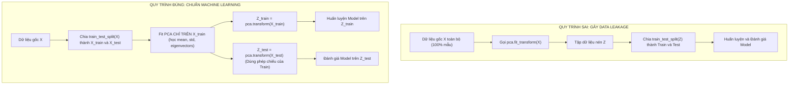

# TÀI LIỆU HƯỚNG DẪN TƯ DUY & LỘ TRÌNH THỰC HÀNH TUẦN 5: PCA
**Môn học:** Machine Learning  
**Chủ đề:** Phân tích thành phần chính (Principal Component Analysis - PCA)  
**Tác giả thực hành:** Nguyễn Hải Anh (MSV: 24001968)  
**Mục tiêu tài liệu:** Cung cấp bản đồ tư duy, nền tảng toán học trực quan, phân tích cạm bẫy kỹ thuật và khung giải pháp chi tiết cho toàn bộ các bài tập trong tuần 5 trước khi bắt tay vào lập trình.

---

## MỤC LỤC
1. [Bản chất toán học và Trực giác hình học của PCA](#1-bản-chất-toán-học-và-trực-giác-hình-học-của-pca)
2. [Cạm bẫy chí mạng: Rò rỉ dữ liệu (Data Leakage) khi kết hợp PCA](#2-cạm-bẫy-chí-mạng-rò-rỉ-dữ-liệu-data-leakage-khi-kết-hợp-pca)
3. [Phân tích chi tiết từng bài tập & Lộ trình thực hiện](#3-phân-tích-chi-tiết-từng-bài-tập--lộ-trình-thực-hiện)
   - [Ví dụ 1: Bộ dữ liệu hoa IRIS (Thủ công Numpy vs Scikit-Learn)](#ví-dụ-1-bộ-dữ-liệu-hoa-iris-thủ-công-numpy-vs-scikit-learn)
   - [Ví dụ 2 (BTH 1): Bộ dữ liệu Parkinson Speech Features (754 chiều)](#ví-dụ-2-bài-tập-thực-hành-1-parkinson-speech-features-754-chiều)
   - [Ví dụ 3 (Tự TH): Hồi quy tuyến tính Y sinh học (Dự đoán độ dày NTM)](#ví-dụ-3-bài-tập-tự-thực-hành-hồi-quy-tuyến-tính-y-sinh-học)
   - [Ví dụ 4 (BTH 3): Dữ liệu ảnh chữ số viết tay MNIST](#ví-dụ-4-bài-tập-thực-hành-3-ảnh-chữ-số-viết-tay-mnist)
   - [Ví dụ 5 (BTH 4): Nhận diện khuôn mặt Eigenfaces (Yale Faces Dataset)](#ví-dụ-5-bài-tập-thực-hành-4-nhận-diện-khuôn-mặt-eigenfaces-yale-faces)
4. [Khung cấu trúc chuẩn cho Notebook (Template)](#4-khung-cấu-trúc-chuẩn-cho-notebook-template)
5. [Bảng tổng hợp Checklist & Mẹo gỡ lỗi (Debugging Tips)](#5-bảng-tổng-hợp-checklist--mẹo-gỡ-lỗi-debugging-tips)

---

## 1. BẢN CHẤT TOÁN HỌC VÀ TRỰC GIÁC HÌNH HỌC CỦA PCA

### 1.1. PCA là gì và sinh ra để làm gì?
Khi làm việc với dữ liệu thực tế (bảng y sinh, tín hiệu âm thanh, dữ liệu ảnh), ta thường đối mặt với:
1. **Lời nguyền số chiều (Curse of Dimensionality):** Khi số chiều $D$ quá lớn so với số lượng quan sát $N$, không gian dữ liệu trở nên cực kỳ thưa thớt, khoảng cách Euclidean mất dần khả năng phân biệt, các mô hình học máy rất dễ bị quá khớp (overfitting).
2. **Đa cộng tuyến (Multicollinearity):** Nhiều thuộc tính phụ thuộc tuyến tính hoặc tương quan rất mạnh với nhau (ví dụ: chiều dài và chiều rộng cánh hoa, hoặc các điểm ảnh cạnh nhau). Điều này gây lãng phí tài nguyên tính toán và gây nhiễu cho các trọng số mô hình.
3. **Nhu cầu trực quan hóa:** Con người chỉ quan sát được tối đa 2D hoặc 3D. Dữ liệu hàng chục, hàng trăm chiều buộc phải nén về 2D/3D để vẽ biểu đồ quan sát ranh giới phân tách lớp.

> **Định nghĩa:** PCA (Principal Component Analysis) là kỹ thuật **trích xuất thuộc tính (Feature Extraction)** không giám sát (unsupervised). PCA chiếu dữ liệu từ không gian ban đầu $D$ chiều xuống một không gian mới $k$ chiều ($k \le D$) sao cho **giữ lại lượng thông tin (phương sai) lớn nhất có thể**.

---

### 1.2. Bản chất hình học: "Xoay hệ trục tọa độ"
- Giả sử dữ liệu ban đầu nằm trên hệ trục chuẩn $[x_1, x_2, \dots, x_D]$. Các thuộc tính này có thể tương quan chéo với nhau (elip dữ liệu bị nghiêng).
- PCA tìm một hệ trục tọa độ trực chuẩn mới $[u_1, u_2, \dots, u_D]$:
  - **Trục $u_1$ (Thành phần chính 1 - $PC_1$):** Là hướng đi qua trọng tâm dữ liệu sao cho **phương sai của các điểm khi chiếu lên trục này là lớn nhất** (tương đương với việc giảm thiểu tối đa sai số bình phương khoảng cách từ các điểm tới trục).
  - **Trục $u_2$ (Thành phần chính 2 - $PC_2$):** Là hướng **vuông góc (trực giao)** với $u_1$ và có phương sai lớn thứ hai.
  - Các trục tiếp theo $u_3, \dots, u_D$ đều trực giao từng đôi một và phương sai giảm dần.
- Khi nén dữ liệu từ $D$ chiều về $k$ chiều, ta chỉ cần giữ lại $k$ trục đầu tiên và bỏ qua $(D - k)$ trục còn lại. Vì các trục mới trực giao nhau nên **độ tương quan tuyến tính giữa các thuộc tính mới hoàn toàn bằng 0**.

---

### 1.3. Pipeline toán học 5 bước kinh điển

```
Dữ liệu gốc X (N mẫu x D chiều)
       │
       ▼
[Bước 1: Chuẩn hóa dữ liệu] ──────► Center về 0 và Scale về cùng phương sai 1
       │
       ▼
[Bước 2: Ma trận hiệp phương sai] ─► C = (1/N) * X^T * X  (kích thước D x D)
       │
       ▼
[Bước 3: Phân tích Trị riêng] ────► Eigenvalues (λ) và Eigenvectors (v) qua Eig hoặc SVD
       │
       ▼
[Bước 4: Sắp xếp & Chọn k trục] ──► Giữ lại k vector riêng ứng với k trị riêng lớn nhất (W_k)
       │
       ▼
[Bước 5: Chiếu dữ liệu] ──────────► Z = X * W_k  (Dữ liệu mới: N mẫu x k chiều)
```

1. **Chuẩn hóa (Standardization):**
   $$x_{std} = \frac{x - \mu}{\sigma}$$
   *Lưu ý cực kỳ quan trọng:* PCA tìm hướng có phương sai lớn nhất. Nếu thuộc tính A đo bằng milimet (phương sai hàng nghìn) và thuộc tính B đo bằng mét (phương sai nhỏ hơn 1), PCA sẽ bị thuộc tính A thống trị dù thuộc tính B có thể chứa thông tin phân loại quan trọng hơn. Bắt buộc phải chuẩn hóa!
2. **Ma trận hiệp phương sai (Covariance Matrix $C$):**
   $$C = \frac{1}{N} X^T X \quad (\text{kích thước } D \times D)$$
   Phần tử trên đường chéo $C_{ii}$ là phương sai của biến $i$. Phần tử ngoài đường chéo $C_{ij}$ là hiệp phương sai giữa biến $i$ và biến $j$.
3. **Phân rã trị riêng / SVD:**
   - Cách 1: Giải phương trình đặc trưng $C v_i = \lambda_i v_i$.
   - Cách 2 (Tối ưu số học): Phân rã kỳ dị SVD (Singular Value Decomposition) trực tiếp trên $X$ hoặc $C$: $X = U \Sigma V^T$. Trị riêng $\lambda_i = \frac{s_i^2}{N}$, và vector riêng chính là các cột của $V$.
4. **Tỷ lệ phương sai giải thích (Explained Variance Ratio):**
   $$\text{EVR}_i = \frac{\lambda_i}{\sum_{j=1}^D \lambda_j}$$
   Cho biết thành phần chính thứ $i$ lưu giữ bao nhiêu % lượng thông tin của toàn bộ dữ liệu.
5. **Chiếu dữ liệu (Projection):**
   $$Z = X \cdot W_k \quad (\text{với } W_k = [v_1, v_2, \dots, v_k] \in \mathbb{R}^{D \times k})$$

---

## 2. CẠM BẪY CHÍ MẠNG: RÒ RỈ DỮ LIỆU (DATA LEAKAGE) KHI KẾT HỢP PCA

Đây là câu hỏi xuất hiện xuyên suốt các bài tập (Ví dụ 1, Ví dụ 2, Ví dụ 4). Người học rất dễ mắc sai lầm này.



### Tại sao Quy trình A là sai lầm?
- Khi bạn gọi `pca.fit(X)` trên toàn bộ dữ liệu, thuật toán đã học giá trị trung bình $\mu$, độ lệch chuẩn $\sigma$ và ma trận hiệp phương sai của **toàn bộ dữ liệu bao gồm cả tập Test**.
- Điều này có nghĩa là tập Train đã được "nhìn trộm" phân bố hình học và các hướng phương sai của tập Test từ trước.
- Kết quả đánh giá trên tập Test sẽ bị **lạc quan quá mức (overly optimistic)**. Khi đem mô hình triển khai thực tế (dữ liệu thật chưa từng nhìn thấy), độ chính xác sẽ tụt giảm nghiêm trọng.

### Quy tắc bất biến:
> **Chỉ được `fit()` hoặc `fit_transform()` trên tập Train.**  
> **Tập Test chỉ được phép gọi `transform()`.**

---

## 3. PHÂN TÍCH CHI TIẾT TỪNG BÀI TẬP & LỘ TRÌNH THỰC HIỆN

---

### VÍ DỤ 1: BỘ DỮ LIỆU HOA IRIS (THỦ CÔNG NUMPY VS SCIKIT-LEARN)

#### 1. Bối cảnh bài toán:
- 150 mẫu hoa, 4 thuộc tính chiều dài/rộng đài hoa và cánh hoa. 3 loài hoa: Setosa, Versicolor, Virginica (mỗi loài 50 mẫu).
- Nhiệm vụ:
  1. Tự lập trình PCA bằng công cụ đại số tuyến tính của Numpy (`svd` và `eig`).
  2. Dùng thư viện `sklearn.decomposition.PCA` để đối chiếu kết quả.
  3. Giảm về 2 chiều để trực quan hóa.
  4. Huấn luyện Logistic Regression và so sánh 3 trường hợp:
     - (a) Dữ liệu gốc 4 chiều.
     - (b.i) Giảm chiều chuẩn: Chia Train-Test rồi mới PCA.
     - (b.ii) Giảm chiều sai: PCA toàn bộ rồi mới chia Train-Test.

#### 2. Tư duy các bước thực hiện:
- **Bước 1: Chuẩn hóa thủ công:**
  ```python
  X_std = (X - X.mean()) / X.std(ddof=0)
  ```
- **Bước 2: Tính ma trận tương quan:**
  ```python
  X_corr = (1 / 150) * X_std.T.dot(X_std)
  ```
- **Bước 3: So sánh SVD vs Eig:**
  - `u, s, v = np.linalg.svd(X_corr)`: Giá trị $s$ chính là các trị riêng (đã được sắp xếp tự động giảm dần). Ma trận $u$ chứa các vector riêng tương ứng.
  - `eig_val, eig_vec = np.linalg.eig(X_corr)`: Cần kiểm tra xem các trị riêng có được sắp xếp giảm dần chưa (nếu chưa, phải dùng `np.argsort` để đảo lại).
- **Bước 4: Chiếu dữ liệu xuống 2 chiều:**
  $$PC_1 = X_{std} \cdot v_1, \quad PC_2 = X_{std} \cdot v_2$$
- **Bước 5: Hiện tượng đảo dấu vector riêng (Sign Ambiguity):**
  - Trong đại số tuyến tính, nếu $v$ là vector riêng ứng với trị riêng $\lambda$ thì $-v$ cũng là vector riêng hợp lệ.
  - Sklearn và Numpy có thể trả về vector riêng ngược dấu nhau $\rightarrow$ biểu đồ có thể bị lật qua trục tung hoặc trục hoành. **Cấu trúc cụm, khoảng cách tương đối và lượng thông tin giữ lại là hoàn toàn như nhau**.
- **Bước 6: Thực nghiệm Logistic Regression:**
  - Tỷ lệ Train:Test = 4:1 (tức 80% train, 20% test).
  - **Bắt buộc sử dụng `stratify=y`** để đảm bảo cả 3 loài hoa xuất hiện cân bằng ở cả tập Train và Test.
  - Đo Accuracy và vẽ Confusion Matrix cho cả 3 kịch bản: Gốc, Quy trình (i), Quy trình (ii).
  - So sánh và giải thích hiện tượng Data Leakage.

---

### VÍ DỤ 2 (BÀI TẬP THỰC HÀNH 1): PARKINSON SPEECH FEATURES (754 CHIỀU)

#### 1. Bối cảnh bài toán:
- Dữ liệu âm thanh giọng nói của bệnh nhân nghi mắc Parkinson (`pd_speech_features.csv`).
- Số lượng mẫu: $N = 756$.
- Số lượng đặc trưng: $D = 754$.
- Cột nhãn: `class` (0: người bình thường, 1: người mắc Parkinson).
- **Đặc trưng thách thức:** $D \approx N$ (số chiều gần bằng số mẫu). Dữ liệu âm thanh có độ tương quan chéo giữa các tần số và formant cực kỳ lớn.

#### 2. Lộ trình giải quyết 5 yêu cầu:

* **Yêu cầu 1: Giảm về 2 chiều để trực quan hóa:**
  - Chuẩn hóa bằng `StandardScaler()`.
  - Áp dụng `PCA(n_components=2)`.
  - Vẽ đồ thị phân tán (Scatter plot) với 2 màu phân biệt nhãn 0 và 1.
  - *Nhận xét dự kiến:* Dữ liệu không phân tách rõ rệt trong không gian 2D vì 2 thành phần chính chỉ giữ được một phần nhỏ tổng phương sai. Cần nhiều chiều hơn để phân loại chính xác.

* **Yêu cầu 2: PCA 200 chiều (Quy trình giảm chiều trước, chia sau):**
  - Fit PCA với $k = 200$ trên toàn bộ 756 mẫu.
  - Lấy 500 mẫu đầu làm Train, 256 mẫu còn lại làm Test.
  - Huấn luyện `LogisticRegression(max_iter=1000)`.
  - Đo `accuracy_score` và in ma trận nhầm lẫn.

* **Yêu cầu 3: PCA 200 chiều (Quy trình chuẩn: chia trước, giảm chiều sau):**
  - Chia dữ liệu gốc: 500 mẫu đầu làm Train, 256 mẫu sau làm Test.
  - Khởi tạo `pca = PCA(n_components=200)`.
  - `X_train_pca = pca.fit_transform(X_train)`.
  - `X_test_pca = pca.transform(X_test)`.
  - Huấn luyện lại Logistic Regression và đo Accuracy.
  - *So sánh:* Đánh giá sự khác biệt giữa Ý 2 và Ý 3.

* **Yêu cầu 4: Lựa chọn số chiều theo ngưỡng phương sai $\ge 80\%$:**
  - Thay vì cố định con số 200, ta dùng tham số động của Sklearn:
    ```python
    pca_80 = PCA(n_components=0.8, svd_solver='full')
    X_train_80 = pca_80.fit_transform(X_train)
    ```
  - **i. Xác định số chiều mới:** `k = pca_80.n_components_`. Kiểm tra xem từ 754 chiều rút xuống còn bao nhiêu chiều để giữ lại 80% phương sai.
  - **ii. Đánh giá phân loại:** Huấn luyện lại Logistic Regression trên $k$ chiều này và so sánh với trường hợp 200 chiều.

* **Yêu cầu 5: So sánh đối đầu: Naive Bayes vs Logistic Regression:**
  - Chia Train:Test tỷ lệ $4:2$ (tương đương 66.7% Train, 33.3% Test).
  - Huấn luyện 2 mô hình: `GaussianNB()` và `LogisticRegression()`.
  - Chạy trên 2 tập dữ liệu:
    1. Dữ liệu gốc 754 chiều.
    2. Dữ liệu đã giảm chiều giữ lại 80% phương sai (ở Ý 4).
  - **Câu hỏi tư duy cốt lõi:** *Mô hình nào có độ chính xác thay đổi nhiều hơn và tại sao?*
    > **Giải thích bản chất lý thuyết:**
    > - Giả định nền tảng của **Naive Bayes** là: *Tất cả các biến độc lập có điều kiện với nhau khi biết nhãn lớp*. Trên dữ liệu gốc 754 chiều, các biến âm thanh tương quan rất mạnh với nhau $\rightarrow$ Giả định Naive Bayes bị vi phạm nặng nề $\rightarrow$ Độ chính xác của Naive Bayes thường thấp.
    > - Khi áp dụng PCA, các thành phần chính mới **hoàn toàn trực giao và không tương quan tuyến tính** $\rightarrow$ Giả định của Naive Bayes được thỏa mãn $\rightarrow$ **Độ chính xác của Naive Bayes thường tăng vọt rõ rệt hơn nhiều so với Logistic Regression**.

---

### VÍ DỤ 3 (BÀI TẬP TỰ THỰC HÀNH): HỒI QUY TUYẾN TÍNH Y SINH HỌC

#### 1. Bối cảnh bài toán:
- Sử dụng bộ dữ liệu Y sinh từ bài thực hành Hồi quy tuyến tính (Tuần 3).
- **Biến mục tiêu ($y$):** Độ dày NTM (Intima-Media Thickness).
- **Các biến độc lập ($X$):** Gồm 5 chỉ số sinh học: Tuổi, Cholesterol, Glucose, Huyết áp tâm thu, BMI.

#### 2. Lộ trình thực hiện:
1. **Lưu ý nguyên tắc:** Tuyệt đối không đưa cột mục tiêu $y$ (độ dày NTM) vào PCA! PCA chỉ áp dụng trên ma trận thuộc tính $X$.
2. Chuẩn hóa 5 biến độc lập bằng `StandardScaler()`.
3. Áp dụng PCA giảm từ 5 chiều về 2 chiều ($PC_1, PC_2$).
4. Vẽ đồ thị phân tán 2D để trực quan hóa sự phân bố của các bệnh nhân.
5. Huấn luyện mô hình `LinearRegression()` trên 2 biến mới $PC_1, PC_2$.
6. So sánh với mô hình Hồi quy tuyến tính chạy trên cả 5 biến ban đầu thông qua 2 chỉ số:
   - $R^2$ Score (Hệ số xác định - đánh giá mức độ giải thích dữ liệu).
   - MSE / RMSE (Sai số bình phương trung bình).
7. **Nhận xét bản chất:** 
   - 2 thành phần chính giải thích được bao nhiêu % phương sai của 5 biến gốc?
   - $R^2$ của mô hình 2D có giảm nhiều so với mô hình 5D không? Nếu giảm rất ít, mô hình 2D là lựa chọn tối ưu hơn vì đơn giản hơn và triệt tiêu được hiện tượng đa cộng tuyến giữa Huyết áp, BMI và Cholesterol.

---

### VÍ DỤ 4 (BÀI TẬP THỰC HÀNH 3): ẢNH CHỮ SỐ VIẾT TAY MNIST

#### 1. Bối cảnh bài toán:
- Dữ liệu ảnh chữ số viết tay $28 \times 28$ pixels $= 784$ chiều.
- Lấy mẫu 5000 ảnh bất kỳ để tối ưu thời gian tính toán.
- Chia tỷ lệ Train:Validation = $7:3$ (3500 ảnh Train, 1500 ảnh Validation).

#### 2. Lộ trình thực hiện:
1. Đọc dữ liệu từ file nén `.gz` hoặc hàm đọc MNIST đã chuẩn bị từ tuần trước. Chuẩn hóa pixel về đoạn $[0, 1]$ (chia cho 255.0).
2. Huấn luyện mô hình phân loại nhiều lớp **Multinomial Logistic Regression (Softmax)** trên:
   - **Trường hợp a:** Dữ liệu gốc 784 chiều.
   - **Trường hợp b:** Dữ liệu giảm xuống 100 chiều theo 2 quy trình:
     * Cách 1: Nén toàn bộ 5000 ảnh trước rồi chia Train:Validation.
     * Cách 2: Chia Train:Validation trước rồi mới nén (Chuẩn ML).
3. Đo lường 2 đại lượng quan trọng:
   - **Độ chính xác (Accuracy).**
   - **Thời gian huấn luyện (Training Execution Time)** bằng thư viện `time.time()`.

#### 3. Bảng so sánh kỳ vọng & Kết luận:
| Tiêu chí | Dữ liệu gốc (784 chiều) | Dữ liệu PCA (100 chiều) | Ý nghĩa kỹ thuật |
| :--- | :--- | :--- | :--- |
| **Kích thước vector** | 784 | 100 | Nén gần 8 lần dung lượng bộ nhớ |
| **Thời gian huấn luyện** | Lâu (nhiều phép tính gradient) | Rất nhanh (hội tụ nhanh hơn nhiều lần) | Lợi ích cực lớn khi huấn luyện dữ liệu lớn |
| **Độ chính xác (Accuracy)** | Rất cao (~90-92%) | Tương đương hoặc giảm rất nhẹ (~89-91%) | 100 chiều đã giữ lại hầu hết thông tin hình dạng số, loại bỏ các pixel biên luôn là màu đen |

---

### VÍ DỤ 5 (BÀI TẬP THỰC HÀNH 4): NHẬN DIỆN KHUÔN MẶT EIGENFACES (YALE FACES)

#### 1. Bối cảnh bài toán:
- Tệp `face_data.zip` chứa 165 ảnh khuôn mặt của 15 người (`subject01` đến `subject15`), mỗi người có 11 biểu cảm/góc sáng: `['centerlight', 'glasses', 'happy', 'leftlight', 'noglasses', 'normal', 'rightlight', 'sad', 'sleepy', 'surprised', 'wink']`.
- Kích thước mỗi ảnh: Cao $H = 320$, Rộng $W = 243 \rightarrow$ Mỗi ảnh là 1 vector $D = 320 \times 243 = 77,760$ chiều!
- Số lượng ảnh: $N = 165$.

#### 2. Phân tích toán học chuyên sâu: Thuật toán Eigenfaces
- Ma trận dữ liệu $X$ có kích thước $165 \times 77,760$.
- Trong đại số tuyến tính:
  $$\text{Hạng của ma trận } \text{rank}(X) \le \min(N, D) = 165$$
  Sau khi trừ đi vector trung bình (center dữ liệu), hạng tối đa của ma trận hiệp phương sai chỉ là $N - 1 = 164$.
- Do đó, **chỉ có tối đa 164 trị riêng khác 0**. Toàn bộ các trị riêng còn lại từ 165 đến 77,760 đều bằng 0 tuyệt đối!
- Đề bài yêu cầu giảm xuống **135 chiều** là hoàn toàn chuẩn xác về mặt toán học. 135 vector riêng này khi vẽ ngược lại thành ảnh $320 \times 243$ được gọi là các **Eigenfaces** (khuôn mặt đặc trưng ma quái - lưu giữ các đặc điểm mắt, mũi, miệng, hướng sáng).

#### 3. Lộ trình thực hiện:
- **Câu a - Giảm số chiều:**
  - Dùng OpenCV (`cv2.imread(..., cv2.IMREAD_GRAYSCALE)`) đọc 165 ảnh và duỗi thành mảng $X$ ($165 \times 77760$).
  - Tạo mảng nhãn $y$ tương ứng với ID của 15 người (mỗi ID lặp lại 11 lần).
  - Áp dụng `PCA(n_components=135)`.
- **Câu b - Phân loại 15 người:**
  - Chia Train:Test theo tỷ lệ $7:3$ (chú ý dùng `stratify=y` để người nào cũng có ảnh trong cả tập Train và Test).
  - Huấn luyện:
    1. **Multinomial Logistic Regression**.
    2. **Gaussian Naive Bayes**.
  - So sánh độ chính xác và vẽ ma trận nhầm lẫn (Confusion Matrix).
- **Câu c - Thử nghiệm với ảnh mới:**
  - Lấy 5 ảnh chân dung bất kỳ đưa về kích thước chuẩn $(320, 243)$ ở dạng ảnh xám (grayscale).
  - Duỗi thành vector $1 \times 77760$.
  - Chiếu qua không gian 135 chiều bằng `pca.transform()`.
  - Đưa vào mô hình đã huấn luyện để dự đoán xem ảnh đó mang đặc trưng giống với `subject` nào nhất trong 15 người.

---

## 4. KHUNG CẤU TRÚC CHUẨN CHO NOTEBOOK (TEMPLATE)

Khi bắt tay vào viết code trong notebook `NguyenHaiAnh_24001968_week5_pca.ipynb`, bạn nên trình bày theo cấu trúc phân tầng khoa học sau:

```python
# ==============================================================================
# BÀI THỰC HÀNH TUẦN 5: PHÂN TÍCH THÀNH PHẦN CHÍNH (PCA)
# Họ và tên: Nguyễn Hải Anh | MSV: 24001968
# ==============================================================================

# Cell 1: Import tất cả các thư viện cần thiết
import numpy as np
import pandas as pd
import matplotlib.pyplot as plt
import seaborn as sns
import os, time, zipfile, warnings
import cv2

from sklearn.decomposition import PCA
from sklearn.preprocessing import StandardScaler
from sklearn.model_selection import train_test_split
from sklearn.linear_model import LogisticRegression, LinearRegression
from sklearn.naive_bayes import GaussianNB
from sklearn.metrics import accuracy_score, confusion_matrix, classification_report, mean_squared_error, r2_score

warnings.filterwarnings('ignore')
%matplotlib inline

# ------------------------------------------------------------------------------
# PHẦN 1: BỘ DỮ LIỆU IRIS (PCA THỦ CÔNG VS SCIKIT-LEARN & DATA LEAKAGE)
# ------------------------------------------------------------------------------
# 1.1. Đọc dữ liệu Iris.csv và chuẩn hóa
# 1.2. PCA thủ công bằng SVD và Eig (Numpy)
# 1.3. Trực quan hóa 2D
# 1.4. Đánh giá Logistic Regression: Dữ liệu gốc vs Giảm chiều (Quy trình i vs ii)
# 1.5. Thảo luận & Kết luận về Data Leakage

# ------------------------------------------------------------------------------
# PHẦN 2: BÀI TẬP THỰC HÀNH 1 - PARKINSON DISEASE SPEECH FEATURES
# ------------------------------------------------------------------------------
# 2.1. Đọc pd_speech_features.csv (754 chiều)
# 2.2. Ý 1: Chiếu về 2D và vẽ Scatter plot
# 2.3. Ý 2 & 3: PCA 200 chiều (So sánh PCA trước chia vs Chia trước PCA)
# 2.4. Ý 4: Chọn số chiều tự động theo ngưỡng 80% Explained Variance
# 2.5. Ý 5: So sánh Naive Bayes vs Logistic Regression (Bàn luận giả định độc lập)

# ------------------------------------------------------------------------------
# PHẦN 3: BÀI TẬP TỰ THỰC HÀNH - HỒI QUY TUYẾN TÍNH DỮ LIỆU Y SINH
# ------------------------------------------------------------------------------
# 3.1. Chuẩn bị 5 biến độc lập và biến mục tiêu NTM
# 3.2. PCA giảm từ 5 chiều về 2 chiều
# 3.3. Huấn luyện Linear Regression: 5D gốc vs 2D PCA
# 3.4. So sánh R2, MSE và nhận xét

# ------------------------------------------------------------------------------
# PHẦN 4: BÀI TẬP THỰC HÀNH 3 - ẢNH CHỮ SỐ VIẾT TAY (MNIST)
# ------------------------------------------------------------------------------
# 4.1. Đọc 5000 mẫu MNIST và chuẩn hóa pixel [0, 1]
# 4.2. PCA giảm từ 784 về 100 chiều
# 4.3. Huấn luyện Multinomial Logistic Regression: Đánh giá Accuracy vs Tốc độ
# 4.4. Thử nghiệm so sánh quy trình rò rỉ dữ liệu

# ------------------------------------------------------------------------------
# PHẦN 5: BÀI TẬP THỰC HÀNH 4 - NHẬN DIỆN KHUÔN MẶT EIGENFACES (YALE FACES)
# ------------------------------------------------------------------------------
# 5.1. Giải nén face_data.zip và đọc 165 ảnh (H=320, W=243, D=77760)
# 5.2. PCA nén về 135 Eigenfaces (Phân tích rank ma trận)
# 5.3. Huấn luyện Softmax Regression & Gaussian Naive Bayes (tỷ lệ 7:3)
# 5.4. Thử nghiệm nhận diện trên 5 ảnh chân dung ngoài thực tế
```

---

## 5. BẢNG TỔNG HỢP CHECKLIST & MẸO GỠ LỖI (DEBUGGING TIPS)

| Tình huống / Vấn đề | Nguyên nhân | Cách xử lý chuẩn |
| :--- | :--- | :--- |
| **Đồ thị PCA của Sklearn bị lật ngược so với Numpy** | Đảo dấu vector riêng (Sign Ambiguity) | Nhân vector của Sklearn với `-1`. Bản chất toán học hoàn toàn tương đương. |
| **Mô hình Logistic Regression báo lỗi `ConvergenceWarning`** | Số chiều lớn hoặc dữ liệu chưa hội tụ trong số bước lặp mặc định (100) | Tăng tham số `max_iter=1000` hoặc `max_iter=2000` trong `LogisticRegression()`. |
| **Đường dẫn tệp CSV/Ảnh báo lỗi `FileNotFoundError`** | Trong đề bài PDF dùng đường dẫn tuyệt đối của máy giảng viên (`D:\\Teach_n_Train\\...`) | **Tuyệt đối dùng đường dẫn tương đối** trong thư mục làm việc, ví dụ: `"iris.csv"`, `"pd_speech_features.csv"`. |
| **Mất cân bằng lớp khi chia Train/Test ngẫu nhiên** | Một số lớp có ít mẫu bị dồn hết vào Train hoặc Test | Luôn thêm tham số `stratify=y` trong `train_test_split()`. |
| **Dung lượng RAM bị tràn khi đọc ảnh Yale Faces** | 165 ảnh $\times$ 77,760 float64 chiếm nhiều bộ nhớ | Chuyển kiểu dữ liệu sang `np.float32` hoặc chuẩn hóa `/ 255.0` để tiết kiệm RAM. |
| **Chạy Naive Bayes trên dữ liệu gốc điểm thấp hơn nhiều so với sau PCA** | Vi phạm giả định độc lập thuộc tính | Đây là hiện tượng hoàn toàn bình thường và là phát hiện khoa học cần nêu rõ trong phần nhận xét! |

---

*Tài liệu này được thiết kế để mở song song bên cạnh file Jupyter Notebook trong suốt quá trình bạn thực hành.*
